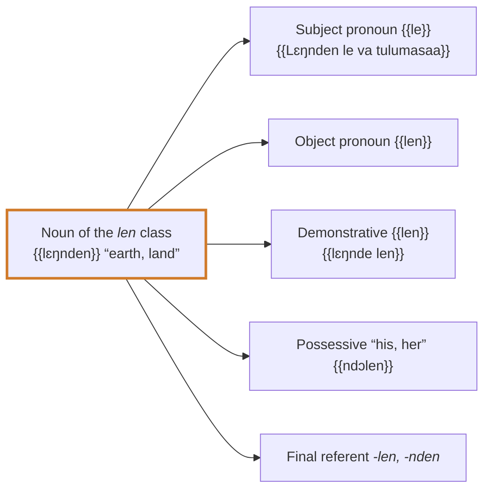

# Agreement: the alliterative structure

## The principle

In Kisiei, the class of a noun **is repeated** on the words that accompany or replace it: subject pronouns, demonstratives, possessives, adjectives, relatives. This system is called the **alliterative structure** [[(Keita1979, p. 121-122)]]; Southern Kissi has the same agreement system, which affects pronouns, adjectives, possessives, demonstratives and small numbers [[(Childs1995, p. 150)]]. It is called alliterative because the same ending comes back like an echo through the sentence. The small words that carry this repetition are the **class referents**.

{{Lɛŋnden le va tulumasaa}} — “The earth (*le*) was without form” [Gen 1:2](https://www.bible.com/bible/1394/GEN.1.2.BKG): {{lɛŋnden}} belongs to the *len* class, and the subject pronoun that refers back to it is {{le}}.

{{Ɲumma bɛndu-bɛnduan ma va matoalaa}} — “The very great waters (*ma*) were…” [Gen 1:2](https://www.bible.com/bible/1394/GEN.1.2.BKG): a noun of the *an* class, taken up by {{ma}}.

{{kobilan la va belaŋɔmpum, lan la va…}} — “The cities (*la*) were sixty, those (*lan la*) were…” [Deut 3:4](https://www.bible.com/bible/1394/DEU.3.4.BKG): a plural in *-lan*, taken up by {{la}} and {{lan}}.

<figure class="ks-figure" markdown="1">

<figcaption>One class, many words: the mark of the <i>len</i> class comes back on every word that refers to the noun (forms from the table below).</figcaption>
</figure>

## Table of referents

The table brings together the forms described in 1979 [[(Keita1979, p. 57-60, 85-86, 121)]] and checked in the Bible [[(BKG)]]. The subject and object pronouns correspond, class by class, to those of Southern Kissi [[(Childs1995, p. 107)]].

| Class | Example | Subject | Object pronoun | Near demonstrative | Far demonstrative | Possessive “his, her” | Final referent |
| --- | --- | --- | --- | --- | --- | --- | --- |
| *o / a / ɔ* sing. | {{cuaa}}, {{yɔmndo}} | {{o}} | {{ndu}} | {{hoo}} | {{kon}} | {{ndɔɔ}} | *-o, -ndo, -yo, -lo* ({{fula-o}}) |
| plural persons | {{vannda}}, {{poaa}} | {{a}} | {{nda}} | {{haa}} | {{kan}} | {{ndɔa}} | *-a, -nda* |
| *i / e* sing. | {{sɔɛi}}, {{ciŋnde}} | {{i}} | {{ndi}} | {{he}} | {{ken}} | {{ndɔɛi}} | *-e, -nde, -ye* |
| *i / e* plur. (*-on*) | {{sɔɔn}}, {{pelon}} | {{n}} | {{mun}} | {{mun}} | {{mun}} | {{ndɔn}} | *-on, -ndon* |
| *an* | {{mɛnndan}} | {{ma}} | {{man}} | {{man}} | {{man}} | {{ndɔan}} | *-an, -ndan* |
| *len* | {{lɛŋnden}}, {{bollen}} | {{le}} | {{len}} | {{len}} | {{len}} | {{ndɔlen}} | *-len, -nden* |
| *lan* | {{diolan}}, {{kobilan}} | {{la}} | {{lan}} | {{lan}} | {{lan}} | {{ndɔlan}} | *-lan, -ndan* |

Remarks:

- The **subject** is the pronoun placed before the verb when the noun is not repeated, or just after the noun to take it up again ({{Lɛŋnden le va}}). In the *o* class, this resumptive pronoun is usually omitted ({{Mí Hala dimi aa}}), as in Southern Kissi [[(Childs1995, p. 108)]].
- The demonstratives of the *an*, *len* and *lan* classes have the same form for “this” and “that”; it is the **tone** that distinguishes them (low for nearness, high for distance) [[(Keita1979, p. 58)]]. In Southern Kissi, the near demonstrative carries a falling tone and the far one a high tone, in all classes [[(Childs1995, p. 110)]].
- The 3rd-person **possessive** takes the ending of the class of the noun possessed, not of the possessor: {{kala ndɔ}} “his mother”, {{poaa ndɔa}} “his sons”, {{diola ndɔlan}} “his name”. See [Possessives](determiners/possessives.md).

## Examples in the Bible

| Class | Example | Translation |
| --- | --- | --- |
| *o* | {{cɛi kon}} | that house [Exod 40:19](https://www.bible.com/bible/1394/EXO.40.19.BKG) |
| *i* | {{sɔɛi he}} | this word [Gen 9:17](https://www.bible.com/bible/1394/GEN.9.17.BKG) |
| *i* | {{sɔɛi ken}} | that word [Gen 14:13](https://www.bible.com/bible/1394/GEN.14.13.BKG) |
| *an* | {{mɛmma man}} | these waters [Gen 1:2](https://www.bible.com/bible/1394/GEN.1.2.BKG) |
| *len* | {{bollen le dendu}} | the head (*le*) has turned white [1 Sam 12:2](https://www.bible.com/bible/1394/1SA.12.2.BKG) |
| *lan* | {{kobilan la va belaŋɔmpum}} | the cities were sixty [Deut 3:4](https://www.bible.com/bible/1394/DEU.3.4.BKG) |
| plural | {{ɲɛm pangelen mun}} | these lights [Gen 1:14](https://www.bible.com/bible/1394/GEN.1.14.BKG) |
| *an* | {{mɛmma diinun man}} | the gathered waters [Gen 1:10](https://www.bible.com/bible/1394/GEN.1.10.BKG) |

## The final referent and the hyphen

When a noun phrase is completed by a relative clause, a complement or a proper noun, the class of the noun is taken up again **at the end of the phrase** by the referent, attached by a hyphen to the last word (see [Word division](../orthography/word-division.md)):

- {{kɔngɔ vesɛi fula-o}} “the dry land that appeared” [Gen 1:10](https://www.bible.com/bible/1394/GEN.1.10.BKG) (*kɔngɔ*, *o* class);
- {{visia pɔmbɔa kela lɛŋ-nda}} “the small creatures that move on the ground” [Gen 1:24](https://www.bible.com/bible/1394/GEN.1.24.BKG) (*visia*, plural of persons/animals);
- {{mɛmma co lebɛngu-an}} “the waters that are below” [Gen 1:7](https://www.bible.com/bible/1394/GEN.1.7.BKG) (*mɛmma*, *an* class);
- {{sɔɛi Mɛlɛka dimul ndu-e}} “the word that the Lord had spoken to him” [Gen 15:6](https://www.bible.com/bible/1394/GEN.15.6.BKG) (*sɔɛi*, *i* class).

!!! rule "Rule"
    To write a pronoun, a demonstrative, a possessive or a referent correctly, you need to know the **class** of the noun and its **number**, then take the corresponding form from the table.

!!! note "Note"
    The forms in the table marked as unattested and the exact distribution of referents for some classes remain to be confirmed; see the [open questions](../reference/open-questions.md).
