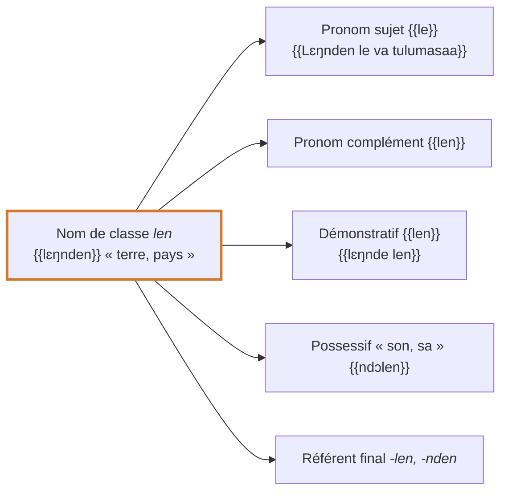

# Accord : la structure allitérative

## Le principe

En kisiei, la classe d'un nom **se répète** sur les mots qui l'accompagnent ou le remplacent : pronoms sujets, démonstratifs, possessifs, adjectifs, relatifs. Ce système est appelé **structure allitérative** [[(Keita1979, p. 121-122)]] ; le kissi du Sud a le même système d'accord, qui touche les pronoms, les adjectifs, les possessifs, les démonstratifs et les petits nombres [[(Childs1995, p. 150)]]. Il est dit allitératif parce que la même terminaison revient comme un écho dans la phrase. Les petits mots qui portent cette reprise sont les **référents de classe**.

{{Lɛŋnden le va tulumasaa}} — « La terre (*le*) était informe » [Gn 1,2](https://www.bible.com/bible/1394/GEN.1.2.BKG) : {{lɛŋnden}} est de classe *len*, et le pronom sujet qui le reprend est {{le}}.

{{Ɲumma bɛndu-bɛnduan ma va matoalaa}} — « Les très grandes eaux (*ma*) étaient… » [Gn 1,2](https://www.bible.com/bible/1394/GEN.1.2.BKG) : nom de classe *an*, repris par {{ma}}.

{{kobilan la va belaŋɔmpum, lan la va…}} — « Les villes (*la*) étaient soixante, celles-là (*lan la*) étaient… » [Dt 3,4](https://www.bible.com/bible/1394/DEU.3.4.BKG) : pluriel en *-lan*, repris par {{la}} et {{lan}}.

<figure class="ks-figure" markdown="1">

<figcaption>Une classe, plusieurs mots : la marque de la classe <i>len</i> revient sur tous les mots qui renvoient au nom (formes du tableau ci-dessous).</figcaption>
</figure>

## Tableau des référents

Le tableau réunit les formes décrites en 1979 [[(Keita1979, p. 57-60, 85-86, 121)]] et vérifiées dans la Bible [[(BKG)]]. Les pronoms sujets et compléments correspondent, classe par classe, à ceux du kissi du Sud [[(Childs1995, p. 107)]].

| Classe | Exemple | Sujet | Pronom complément | Démonstratif proche | Démonstratif éloigné | Possessif « son, sa » | Référent final |
| --- | --- | --- | --- | --- | --- | --- | --- |
| *o / a / ɔ* sing. | {{cuaa}}, {{yɔmndo}} | {{o}} | {{ndu}} | {{hoo}} | {{kon}} | {{ndɔɔ}} | *-o, -ndo, -yo, -lo* ({{fula-o}}) |
| personnes plur. | {{vannda}}, {{poaa}} | {{a}} | {{nda}} | {{haa}} | {{kan}} | {{ndɔa}} | *-a, -nda* |
| *i / e* sing. | {{sɔɛi}}, {{ciŋnde}} | {{i}} | {{ndi}} | {{he}} | {{ken}} | {{ndɔɛi}} | *-e, -nde, -ye* |
| *i / e* plur. (*-on*) | {{sɔɔn}}, {{pelon}} | {{n}} | {{mun}} | {{mun}} | {{mun}} | {{ndɔn}} | *-on, -ndon* |
| *an* | {{mɛnndan}} | {{ma}} | {{man}} | {{man}} | {{man}} | {{ndɔan}} | *-an, -ndan* |
| *len* | {{lɛŋnden}}, {{bollen}} | {{le}} | {{len}} | {{len}} | {{len}} | {{ndɔlen}} | *-len, -nden* |
| *lan* | {{diolan}}, {{kobilan}} | {{la}} | {{lan}} | {{lan}} | {{lan}} | {{ndɔlan}} | *-lan, -ndan* |

Remarques :

- Le **sujet** est le pronom placé devant le verbe quand le nom n'est pas répété, ou juste après le nom pour le reprendre ({{Lɛŋnden le va}}). Dans la classe *o*, ce pronom de reprise est en général omis ({{Mí Hala dimi aa}}), comme en kissi du Sud [[(Childs1995, p. 108)]].
- Les démonstratifs des classes *an*, *len* et *lan* ont la même forme pour « ce…-ci » et « ce…-là » ; c'est le **ton** qui les distingue (bas pour la proximité, haut pour l'éloignement) [[(Keita1979, p. 58)]]. En kissi du Sud, le proche porte un ton descendant et l'éloigné un ton haut, dans toutes les classes [[(Childs1995, p. 110)]].
- Le **possessif** de la 3e personne prend la terminaison de la classe du nom possédé, non du possesseur : {{kala ndɔ}} « sa mère », {{poaa ndɔa}} « ses fils », {{diola ndɔlan}} « son nom ». Voir [Possessifs](determiners/possessives.md).

## Exemples dans la Bible

| Classe | Exemple | Traduction |
| --- | --- | --- |
| *o* | {{cɛi kon}} | cette maison-là [Ex 40,19](https://www.bible.com/bible/1394/EXO.40.19.BKG) |
| *i* | {{sɔɛi he}} | cette parole-ci [Gn 9,17](https://www.bible.com/bible/1394/GEN.9.17.BKG) |
| *i* | {{sɔɛi ken}} | cette parole-là [Gn 14,13](https://www.bible.com/bible/1394/GEN.14.13.BKG) |
| *an* | {{mɛmma man}} | ces eaux [Gn 1,2](https://www.bible.com/bible/1394/GEN.1.2.BKG) |
| *len* | {{bollen le dendu}} | la tête (*le*) a blanchi [1 S 12,2](https://www.bible.com/bible/1394/1SA.12.2.BKG) |
| *lan* | {{kobilan la va belaŋɔmpum}} | les villes étaient soixante [Dt 3,4](https://www.bible.com/bible/1394/DEU.3.4.BKG) |
| pluriel | {{ɲɛm pangelen mun}} | ces luminaires [Gn 1,14](https://www.bible.com/bible/1394/GEN.1.14.BKG) |
| *an* | {{mɛmma diinun man}} | les eaux rassemblées [Gn 1,10](https://www.bible.com/bible/1394/GEN.1.10.BKG) |

## Le référent final et le trait d'union

Quand un groupe nominal est complété par une relative, un complément ou un nom propre, la classe du nom est reprise **à la fin du groupe** par le référent, attaché par un trait d'union au dernier mot (voir [Coupure des mots](../orthography/word-division.md)) :

- {{kɔngɔ vesɛi fula-o}} « la terre sèche qui est apparue » [Gn 1,10](https://www.bible.com/bible/1394/GEN.1.10.BKG) (*kɔngɔ*, classe *o*) ;
- {{visia pɔmbɔa kela lɛŋ-nda}} « les petites bêtes qui marchent par terre » [Gn 1,24](https://www.bible.com/bible/1394/GEN.1.24.BKG) (*visia*, pluriel de personnes/animaux) ;
- {{mɛmma co lebɛngu-an}} « les eaux qui sont en bas » [Gn 1,7](https://www.bible.com/bible/1394/GEN.1.7.BKG) (*mɛmma*, classe *an*) ;
- {{sɔɛi Mɛlɛka dimul ndu-e}} « la parole que le Seigneur lui avait dite » [Gn 15,6](https://www.bible.com/bible/1394/GEN.15.6.BKG) (*sɔɛi*, classe *i*).

!!! rule "Règle"
    Pour écrire correctement un pronom, un démonstratif, un possessif ou un référent, il faut connaître la **classe** du nom et son **nombre**, puis prendre la forme correspondante dans le tableau.

!!! note "Note"
    Les formes du tableau marquées comme non attestées et la répartition exacte des référents pour certaines classes restent à confirmer ; voir les [questions ouvertes](../reference/open-questions.md).
