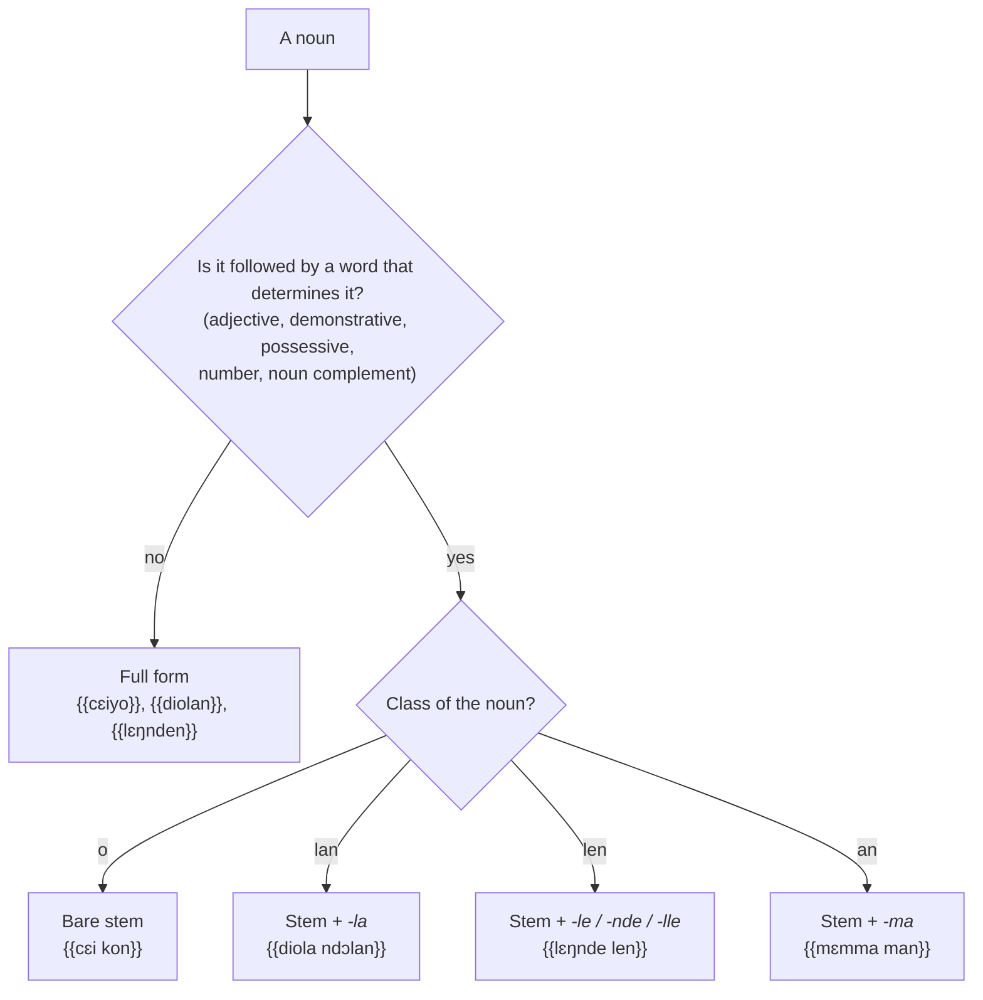

# Noun classes

## The principle

Every Kisiei noun consists of a **stem**, which carries the meaning, and a **class suffix** (also called *morpheme* or *nominal modality* [[(Keita1979, p. 20-22)]]), which indicates the class of the noun and its number:

| Noun | Stem | Suffix | Meaning |
| --- | --- | --- | --- |
| {{yɔmndo}} | {{yɔm}} | *-ndo* | tree |
| {{cɛiyo}} | {{cɛi}} | *-yo* | house |
| {{diolan}} | {{diola}} | *-n* (*lan* class) | name |
| {{mɛnndan}} | *mɛn-* | *-ndan* | water |
| {{nawvo}} | {{naw}} | *-vo* | cow |

The suffix is not just a word ending: it **comes back** on the words that accompany the noun (determiners, pronouns, relatives). This is the **agreement** system described on the [Agreement](../agreement.md) page.

## Full form and stem form

The noun has two forms:

- the **full form** (stem + suffix): when the noun stands alone, or at the end of a phrase;
- the **stem form** (stem alone): when the noun is followed by a word that determines it — adjective, demonstrative, possessive, number, noun complement. The suffix then moves onto that word.

| Full form | Stem form + determiner |
| --- | --- |
| {{cɛiyo}} “the house” | {{cɛi kon}} “that house” |
| {{yɔmndo}} “the tree” | {{yɔm kon}} “that tree” |
| {{diolan}} “the name” | {{diola ndɔlan}} “his name” |
| {{kalaa}} “the mother” | {{kala ndɔ}} “his mother” |
| {{pɔmbɔɔ}} “the younger sibling” | {{pɔmbɔ ndɔ}} “his younger brother” |

The stem form is also called the **indefinite form**, and the full form the **definite form** [[(Keita1979, p. 20)]]; the full form indeed plays the role of the French definite article, which Kisiei does not have.

!!! rule "Rule"
    The suffix is never written twice: *cɛiyo kon* is wrong; write {{cɛi kon}}.

### *lan*, *len* and *an* classes: stem + class pronoun

In the *o* class, the stem form is the bare stem ({{cɛi kon}}). In the ***lan***, ***len*** and ***an*** classes, the Bible [[(BKG)]] writes before the determiner the stem **followed by the class pronoun** without its final nasal: *-la*, *-le*, *-ma*. After a nasal, *-le* becomes *-nde*; after *l*, *-lle*. The 1979 manual mentions this only for the *an* class [[(Keita1979, p. 122)]]; the same construction is described in Southern Kissi (“noun + class pronoun + adjective”) [[(Childs1995, p. 150)]].

| Full form | Stem form | Example (Bible) |
| --- | --- | --- |
| {{diolan}} “name” | {{diola}} | {{diola ndalan}} “their names” [Gen 10:32](https://www.bible.com/bible/1394/GEN.10.32.BKG) |
| {{kobilan}} “cities” | {{kobila}} | {{kobila lan}} “these cities” [Gen 19:25](https://www.bible.com/bible/1394/GEN.19.25.BKG) |
| {{lɛŋnden}} “land” | {{lɛŋnde}} | {{lɛŋnde Havila len}} “the land of Havilah” [Gen 2:11](https://www.bible.com/bible/1394/GEN.2.11.BKG) |
| {{bollen}} “head” | {{bolle}} | {{bolle ndɔlen}} “its top” [Gen 11:4](https://www.bible.com/bible/1394/GEN.11.4.BKG) |
| {{nilen}} “ear” | {{nile}} | {{nile tiilannde}} “the lobe of the ear” [Exod 29:20](https://www.bible.com/bible/1394/EXO.29.20.BKG) |
| {{mɛnndan}} “water” | {{mɛmma}} | {{mɛmma co lebɛngu-an}} “the waters that are below” [Gen 1:7](https://www.bible.com/bible/1394/GEN.1.7.BKG) |
| {{koovan}} “blood” | {{kooma}} | {{kooma pɔmbɔ nɔmndan}} “your brother’s blood” [Gen 4:10](https://www.bible.com/bible/1394/GEN.4.10.BKG) |
| {{cuɛiyan}} “oil” | {{cuɛima}} | |

**Plurals in *-lan*** follow the same rule: their stem form ends in *-la* (*-nda* after a nasal), as in the Bible: {{tɔŋnda nilan}} “my commandments” [Gen 26:5](https://www.bible.com/bible/1394/GEN.26.5.BKG), {{yungula}} “the families” [Gen 10:32](https://www.bible.com/bible/1394/GEN.10.32.BKG), {{vɔsila bɔɔ-bɔɔ}} “many years” [Gen 24:1](https://www.bible.com/bible/1394/GEN.24.1.BKG).

!!! rule "Rule"
    Before a determiner, write as a single word: *stem + la* (*lan* class), *stem + le / nde / lle* (*len* class), *stem + ma* (*an* class): {{diola ndɔlan}}, {{lɛŋnde len}}, {{mɛmma man}}.

<figure class="ks-figure" markdown="1">

<figcaption>Full form or stem form? Before a determiner, the <i>lan</i>, <i>len</i> and <i>an</i> classes add the class pronoun to the stem.</figcaption>
</figure>

## The classes

Eight suffixes are distinguished [[(Keita1979, p. 22-25)]], grouped here into classes according to their plural and their referents. The suffixes have variants that depend on the end of the stem (after a nasal, *-nd-* is found; after *l*, *-l-* or *-t-*; after *w*, *-v-*; after *i*, *-y-*). The same variants are described for Southern Kissi [[(Childs1995, p. 151-156)]].

| Class | Singular suffixes | Typical content | Examples (Bible) |
| --- | --- | --- | --- |
| **o / a / ɔ** | *-o, -ndo, -vo, -lo, -yo*; *-a*; *-ɔ* | living beings (people, animals) and many objects | {{yɔmndo}} “tree”, {{nawvo}} “cow”, {{kalaa}} “mother”, {{pɔmbɔɔ}} “younger sibling”, {{miallo}} “stranger” |
| **i** | *-i, -ei, -ɛi* | certain solid objects, names of languages | {{pelei}} “foot”, {{mɔɛi}} “knife”, {{kelɛi}} “bracelet”, {{sɔɛi}} “word” |
| **e** | *-e, -ye, -nde, -ve, -le* | grains, countable objects, collections | {{ciŋnde}} “tooth”, {{yɛiye}} “seed” |
| **an** | *-an, -yan, -van, -ndan* | liquids, masses | {{mɛnndan}} “water”, {{koovan}} “blood”, {{cuɛiyan}} “oil” |
| **lan** | *-lan, -tan, -ndan* | abstract nouns; and the plural of many nouns | {{diolan}} “name”, {{yolan}} “dance” |
| **len** | *-len, -ten, -nden* | fruits, certain body parts, soft objects; diminutives | {{nilen}} “ear”, {{bollen}} “head”, {{lɛŋnden}} “land” |

The *i* and *e* series form a single class in Southern Kissi: there the ending *-e* becomes *-ei* or *-ɛi* after a stem ending in a vowel [[(Childs1995, p. 148, 153)]]. The Bible points the same way: nouns of both series are taken up by the same pronoun {{i}}, have the same referent *-e* (see [Agreement](../agreement.md)) and the same plural in *-on*.

The main meanings are also found in Southern Kissi: grains and names of languages in the *i* class, diminutives in the *le* (*len*) class, liquids in the *ma* (*an*) class [[(Childs1995, p. 165-169)]]. Abstract nouns, on the other hand, belong there mostly to the *le* class [[(Childs1995, p. 169)]].

The plural is covered on the [Plural](plural.md) page.

!!! note "Comparison: Southern Kissi"
    For Southern Kissi, the classes are named after their pronoun [[(Childs1995, p. 148-149)]]: *o*, *a*, *i*, *ŋ*, *le*, *la*, *ma*. The most frequent singular/plural pairs are *o/la* (things), *o/a* (people, animals) and *i/ŋ*; next come *le/i*, *le/la*, *le/ma* and *o/i*. The plural in *-on* of the 1979 description ({{pelon}}, {{sɔɔn}}) corresponds to the *ŋ* class of that analysis. The same system is found in Kisiei of Guinea, with different forms in the details.

## What the Bible shows

The Bible confirms the broad outlines of the system described in 1979: full form and stem form, class suffixes and repetition of the class on determiners. It adds two clarifications:

1. Suffixes in *-nd-* keep the final nasal of the stem, whether it is *n* or *ŋ*: {{mɛnndan}} (stem *mɛn-*), but {{lɛŋnden}} (stem {{lɛŋ}}). See [Consonants](../../orthography/consonants.md#n-and).
2. When a noun phrase ends with a relative clause or a complement, the class of the noun is **taken up again at the end of the phrase** by a referent attached with a hyphen ({{kɔngɔ vesɛi fula-o}}). See [Agreement](../agreement.md).

## Masculine and feminine

Kisiei has no grammatical gender. To specify the sex of a being, *piaando* “male” or *laando* “female” is added to the stem form [[(Keita1979, p. 28)]]: {{so piaando\|r}} “stallion”, {{so laando\|r}} “mare”. The same device is described in Southern Kissi for animals [[(Childs1995, p. 216-217)]]. The Bible uses these words in the plural for children: {{a piaandua a à laandua}} “sons and daughters” [Gen 5:4](https://www.bible.com/bible/1394/GEN.5.4.BKG).
