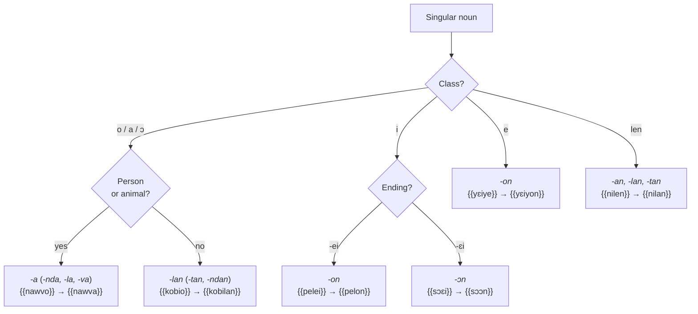

# Plural

The plural is formed by **replacing the singular suffix** with a plural suffix. Which suffix? That depends on the class of the noun and, for the *o / a / ɔ* class, on what the noun refers to [[(Keita1979, p. 26-29)]]. All the pairs below are attested in the Bible [[(BKG)]].

<figure class="ks-figure" markdown="1">

<figcaption>Choosing the plural suffix. Exceptions and nouns without a plural are covered below.</figcaption>
</figure>

## Rules

### People and animals: -a

Nouns for people and animals in *-o*, *-ɔ* or *-a* form their plural in **-a** (*-nda* after a nasal, *-la* after *l*, *-va* after *w*). In Southern Kissi too, the *o / a* pair covers practically all animate beings [[(Childs1995, p. 163-164)]]:

| Singular | Plural | Meaning |
| --- | --- | --- |
| {{nawvo}} | {{nawva}} | cow(s) |
| {{yowvo}} | {{yowva}} | bird(s) |
| {{kɛwvo}} | {{kɛwva}} | snake(s) |
| {{cuinndo}} | {{cuinnda}} | goat(s) |
| {{miallo}} | {{mialla}} | stranger(s) |
| {{vanndo}} | {{vannda}} | person(s), people |
| {{pɔmbɔɔ}} | {{pɔmbɔa}} | younger sibling(s) |
| {{poo}} | {{poaa}} | son(s) |
| {{lanɔɔ}} | {{laandua}} | woman/women, wife/wives |
| {{cuaa}} | {{cuavaa}} | child(ren); in the singular, often “(young) woman” ([Gen 3:13](https://www.bible.com/bible/1394/GEN.3.13.BKG)) |

### Things in -o, -a, -ɔ: -lan

Nouns for things in *-o*, *-ɔ* or *-a* form their plural in **-lan** (*-tan* after *l*, *-ndan* after a nasal). This is the most frequent pair in Southern Kissi (*o / la*), where it also takes in loanwords [[(Childs1995, p. 149, 163)]]:

| Singular | Plural | Meaning |
| --- | --- | --- |
| {{kobio}} | {{kobilan}} | town(s) |
| {{domaa}} | {{domalan}} | shirt(s), garment(s) |
| {{naa}} | {{naalan}} | illness(es) |
| {{paa}} | {{paalan}} | bone(s) |

### *i* class: -on, -ɔn, -an

Nouns in *-ei* form their plural in **-on**; those in *-ɛi*, in **-ɔn** [[(Keita1979, p. 27-28)]]. This is the *i / ŋ* pair of Southern Kissi [[(Childs1995, p. 164)]]:

| Singular | Plural | Meaning |
| --- | --- | --- |
| {{pelei}} | {{pelon}} | foot/feet |
| {{suei}} | {{suon}} | finger(s) |
| {{mɔɛi}} | {{mɔɔn}} | knife/knives |
| {{sɔɛi}} | {{sɔɔn}} | word(s) |
| {{kelɛi}} | {{kelan}} | bracelet(s) — exception in *-an* |

### *e* class: -on

| Singular | Plural | Meaning |
| --- | --- | --- |
| {{yɛiye}} | {{yɛiyon}} | seed(s) |
| *kulle* | {{kullon}} | grain(s) |

### *len* class: -an, -lan, -tan

| Singular | Plural | Meaning |
| --- | --- | --- |
| {{nilen}} | {{nilan}} | ear(s) |
| {{bollen}} | {{bóltan}} | head(s) |
| *pelten* [[(Keita1979, p. 28)]] | {{peltan}} | egg(s) |

### Exceptions

The following exceptions appear in the 1979 description [[(Keita1979, p. 27)]]:

- *-o* → *-e*: *kollo / kolle* “kola nut”, *hollo / holle* “mushroom”.
- *-o* → *-on*: {{cieo}} / {{cieon}} “village(s)”, *kilio / kilion*.
- Invariable: {{saa}} “sheep”, *yangaa* “shrimp(s)”, {{ɲinaa}} “spirit(s), demon(s)”.

The first two types correspond to rarer pairs also described for Southern Kissi, *o / i* and *o / ŋ*; the word for “town, village” appears there precisely in the *o / ŋ* pair [[(Childs1995, p. 149, 167)]].

## Nouns without a plural

- **Masses and liquids** are used only in the singular: {{hɛlle}} “salt”, {{mɛnndan}} “water”.
- Neither are **abstract nouns**: {{diolan}} “name”, {{hangullo}} “heat”, {{ɲumndan}} “darkness”.
- Some **collectives** exist only in the plural: {{diallon}} “the body”.

Southern Kissi also classes “name” and “darkness” among nouns without a plural [[(Childs1995, p. 169-170)]].

## Plural and agreement

The plural also changes the words that agree with the noun. People in the plural are taken up by {{nda}} “them”, things in *-lan* by {{lan}}, and so on: {{poaa ndɔa}} “his sons”, {{diola ndɔlan}} “his name”. See [Agreement](../agreement.md).

!!! note "Note"
    For a noun not found in the Bible, follow these rules, but the plural form must be confirmed by a speaker: several nouns have irregular plurals (about a dozen are listed in the 1979 description [[(Keita1979, p. 26-29)]]).
