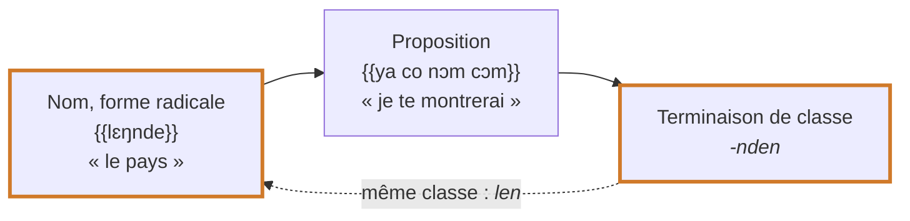

# Propositions relatives

Le kisiei n'a pas de pronom relatif séparé comme le français *qui*, *que*. La relative est encadrée par la **classe du nom** : le nom perd sa terminaison, la relative suit, et la terminaison de classe revient **à la fin de la relative**, attachée par un trait d'union au dernier mot. Les règles de cette page sont dégagées des textes de la Bible en kisiei [[(BKG)]] ; la même structure est décrite pour le kissi du Sud [[(Childs1995, p. 285-288)]].

## Structure

> **nom (forme radicale) + [proposition] + -terminaison de classe**

| Exemple (Bible) | Analyse | Sens |
| --- | --- | --- |
| {{kɔngɔ vesɛi fula-o}} | *kɔngɔ vesɛi* [*fula*]-*o* | la terre sèche qui est apparue [Gn 1,10](https://www.bible.com/bible/1394/GEN.1.10.BKG) |
| {{mɛmma co lebɛngu-an}} | *mɛm-ma* [*co lebɛngu*]-*an* | les eaux qui sont en bas [Gn 1,7](https://www.bible.com/bible/1394/GEN.1.7.BKG) |
| {{visia pɔmbɔa kela lɛŋ-nda}} | *visia pɔmbɔa* [*kela lɛŋ*]-*nda* | les petites bêtes qui marchent par terre [Gn 1,24](https://www.bible.com/bible/1394/GEN.1.24.BKG) |
| {{sɔɛi Mɛlɛka dimul ndu-e}} | *sɔɛi* [*Mɛlɛka dimul ndu*]-*e* | la parole que le Seigneur lui avait dite [Gn 15,6](https://www.bible.com/bible/1394/GEN.15.6.BKG) |
| {{lɔma ya sɔl-lan}} | *lɔma* [*ya sɔl*]-*lan* | le rêve que j'ai fait [Gn 37,6](https://www.bible.com/bible/1394/GEN.37.6.BKG) |
| {{lɛŋnde ya co nɔm cɔm-nden}} | *lɛŋnde* [*ya co nɔm cɔm*]-*nden* | le pays que je te montrerai [Gn 12,1](https://www.bible.com/bible/1394/GEN.12.1.BKG) |
| {{ɲɛm vanaa kan ndáà manda le dioo-on}} | *ɲɛm* [*vanaa kan ndáà manda le dioo*]-*on* | les vivres que ces gens avaient gardés pour manger [Gn 14,11](https://www.bible.com/bible/1394/GEN.14.11.BKG) |

<figure class="ks-figure" markdown="1">

<figcaption>La relative est encadrée par la classe du nom : {{lɛŋnde ya co nɔm cɔm-nden}} « le pays que je te montrerai » (Gn 12,1).</figcaption>
</figure>

Dans les classes *an*, *len* et *lan*, le nom garde devant la relative son **pronom de classe** ({{mɛmma}} = *mɛm-* + *ma*, {{lɛŋnde}}, {{kobila}}), comme devant un adjectif ; dans la classe *o*, le radical est nu ({{kɔngɔ}}). Voir [Classes nominales](../nouns/noun-classes.md).

Souvent, un démonstratif {{hoo}} « ce…-ci » ou {{kon}} « ce…-là » se place à la fin de la relative, juste avant la terminaison : {{Kpema ya yii hoo-o}} « l'alliance que j'établis » [Gn 17,7](https://www.bible.com/bible/1394/GEN.17.7.BKG), {{fonda n sim kon-ndo}} « l'endroit où tu te tiens » [Gn 13,14](https://www.bible.com/bible/1394/GEN.13.14.BKG), {{dɛnɛ n tosa hoo-o}} « la chose que tu as faite » [Gn 3,14](https://www.bible.com/bible/1394/GEN.3.14.BKG). Le kissi du Sud emploie aussi un démonstratif à l'intérieur de la relative, surtout quand le nom relativisé est placé en tête de phrase comme thème [[(Childs1995, p. 288-289)]].

## La terminaison finale

La terminaison qui ferme la relative est celle de la classe du nom ; elle change de forme selon le **dernier son du mot** auquel elle s'attache, exactement comme les terminaisons de noms [[(Childs1995, p. 151-153)]] :

| Classe | après voyelle | après nasale | après *l* | après *i* |
| --- | --- | --- | --- | --- |
| *o* (sing.) | {{-o}} : {{fula-o}} | *-ndo* : {{nin-ndo}} | *-lo* : {{hɔl-lo}} | *-yo* : {{paangei-yo}} |
| personnes plur. | *-a* : {{coocoo-a}} | *-nda* : {{lɛŋ-nda}} | *-la* | *-ya* : {{ikɛi-ya}} |
| *i* | *-e* : {{ndu-e}} | *-nde* : {{can-nde}} | *-le* : {{del-le}} | *-ye* |
| *an* | *-an* : {{lebɛngu-an}} | *-ndan* : {{nin-ndan}} | *-tan* | *-yan* |
| *len* | *-len* | *-nden* : {{cɔm-nden}} | *-ten* : {{Israɛl-ten}} | |
| *lan* | *-lan* | *-ndan* | *-lan* : {{sɔl-lan}} | |
| plur. en *-on* | *-on* : {{dioo-on}} | *-ndon* : {{mún-ndon}} | *-lon* | *-yon* : {{landei-yon}} |

Après *w*, *-o*, *-a* et *-on* deviennent *-vo*, *-va*, *-von* ({{cɔw-von}} [Gn 1,31](https://www.bible.com/bible/1394/GEN.1.31.BKG)).

## Le sujet de la relative

Dans la relative, les pronoms sujets ne sont pas ceux de la phrase simple ({{i}}, {{a}}, {{o}}…) : ils forment une série propre, la même que dans les [questions](../determiners/interrogatives.md).

| Personne | Phrase simple | Relative, question | Exemple (Bible) |
| --- | --- | --- | --- |
| 1re sing. | {{i}} | {{ya}} | {{lɔma ya sɔl-lan}} « le rêve que j'ai fait » [Gn 37,6](https://www.bible.com/bible/1394/GEN.37.6.BKG) |
| 2e sing. | {{a}} | {{n}} | {{dɛnɛ n tosa hoo-o}} « la chose que tu as faite » [Gn 3,14](https://www.bible.com/bible/1394/GEN.3.14.BKG) ; {{fonda n yeema-o}} « l'endroit que tu veux » [Gn 13,9](https://www.bible.com/bible/1394/GEN.13.9.BKG) |
| 3e sing. | {{o}} | {{o}} | {{ɲɛm o cɔw-von}} « les choses qu'il avait créées » [Gn 1,31](https://www.bible.com/bible/1394/GEN.1.31.BKG) |
| 1re plur. | {{n}} | {{naa n}} | {{lɔma naa n sɔl man-ndan}} « les rêves que nous avons faits » [Gn 41,12](https://www.bible.com/bible/1394/GEN.41.12.BKG) |
| 2e plur. | {{la}} | {{niaa}} | {{lɔma niaa sɔl-lan}} « le rêve que vous avez fait » [Gn 40,8](https://www.bible.com/bible/1394/GEN.40.8.BKG) |
| 3e plur. | {{a}} | {{ndáà}} | {{ɲɛm ndáà yoo ndu-on}} « les choses qu'ils lui apportaient » [Gn 43,26](https://www.bible.com/bible/1394/GEN.43.26.BKG) |

Attention : {{n}} vaut « tu » dans une relative ou une question, mais « nous » dans la phrase simple.

Quand le nom lui-même est le sujet de la relative, le verbe suit directement : {{kɔngɔ vesɛi fula-o}}.

## Relative de lieu ou de temps

Les noms de lieu et de temps se relativisent de la même façon :

- {{fonda ni ya va baalaa-o}} « l'endroit où je travaillais » [Gn 41,13](https://www.bible.com/bible/1394/GEN.41.13.BKG) ;
- {{kobila va o dɛɛla kon nin-ndan}} « les villes qui étaient dans cette plaine » [Gn 13,12](https://www.bible.com/bible/1394/GEN.13.12.BKG).

!!! rule "Règles d'écriture"
    - La terminaison de classe qui ferme la relative s'attache au **dernier mot** de la relative par un **trait d'union** : {{fula-o}}, {{sɔl-lan}}, {{cɔm-nden}}.
    - Le trait d'union se met même si le dernier mot est une postposition ({{coo-o}}, {{nin-ndan}}) ou un nom propre ({{Israɛl-ten}}).
    - Ne pas écrire la terminaison comme un mot séparé.

!!! keita "Usage de 1979"
    La description de 1979 présente ces terminaisons comme des **pronoms relatifs** séparés, placés après le verbe : *vo, ve, van, len, lan*, pluriel *va, von* [[(Keita1979, p. 88-89)]] (*Domaa n pendu vo sèsa* « la chemise que tu as achetée est belle »). La Bible les rattache au dernier mot de la relative par un trait d'union ; c'est cet usage qui fait foi. Voir [Coupure des mots](../../orthography/word-division.md).
