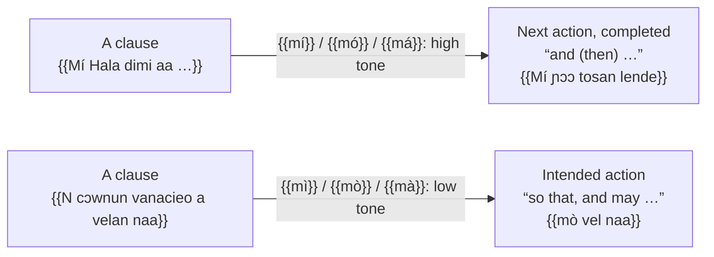
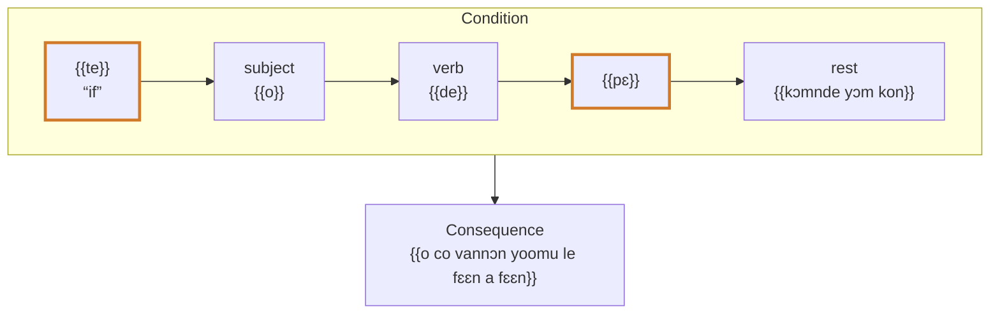

# The complex sentence

The rules on this page are drawn from the texts of the Kisiei Bible [[(BKG)]]. The conjunctions themselves are presented on the [Prepositions, postpositions and conjunctions](../small-words/prepositions-conjunctions.md) page.

## Narrative sequence: *mí*, *mó*, *má*

Narrative links clauses together with {{mí}} + pronoun (high tone): {{Mí Hala dimi aa … Mí ɲɔɔ tosan lende}} “And God said… And it was so” [Gen 1:6-7](https://www.bible.com/bible/1394/GEN.1.6.BKG). Each new action is a clause introduced by {{mí}}, {{mó}} or {{má}}; see [Tense, aspect, mood](../verbs/tense-aspect-mood.md#narrative-and-subjunctive-mi-pronoun).

<figure class="ks-figure" markdown="1">

<figcaption>Linking (high tone) or aiming at a purpose (low tone): the tone of <i>mi</i> + pronoun makes the difference (Gen 1:6-7; Gen 1:26).</figcaption>
</figure>

## Purpose and consequence

| Construction | Meaning | Example |
| --- | --- | --- |
| {{mì}} / {{mò}} / {{mà}} + verb | so that, and may | {{N cɔwnun vanacieo a velan naa, mò vel naa}} “Let us make man in our image, so that he resembles us” [Gen 1:26](https://www.bible.com/bible/1394/GEN.1.26.BKG) |
| {{haliko}} {{mi}} … | in order that | {{haliko mi la va baloo dɔwnɔnndo}} “so that it may be your food” [Gen 1:29](https://www.bible.com/bible/1394/GEN.1.29.BKG) |
| {{le}} + long form | in order to (do) | {{le dioo}} “to eat” [Gen 3:11](https://www.bible.com/bible/1394/GEN.3.11.BKG) |

## Cause

{{kani}} “for, because” and {{le tùú}} “because” introduce the cause: {{kani o falun vanapɔnɔɔ nin}} “for she was taken out of man” [Gen 2:23](https://www.bible.com/bible/1394/GEN.2.23.BKG); {{Le tùú n cɛl sɔɛi laa nɔm-nde}} “because you listened to the voice of your wife” [Gen 3:17](https://www.bible.com/bible/1394/GEN.3.17.BKG). {{lelan}} and {{le hee}} “that is why” introduce the consequence [Gen 2:24](https://www.bible.com/bible/1394/GEN.2.24.BKG).

## Condition: *te … pɛ*

The condition opens with {{te}} and closes with {{pɛ}}, placed just **after the verb** of the condition; the consequence follows:

- {{te o de pɛ kɔmnde yɔm kon, o co vannɔn yoomu le fɛɛn a fɛɛn}} “if he eats of the fruit of this tree, he will live for ever” [Gen 3:22](https://www.bible.com/bible/1394/GEN.3.22.BKG);
- unreal condition with the lengthened pronoun: {{te yáà de pɛ visin}} “if I had eaten meat” [Lev 10:19](https://www.bible.com/bible/1394/LEV.10.19.BKG).

A negative condition keeps {{pɛ}} and places the negation at the end of the condition: {{Kɛ taa liila ya le, i kuenin te}} “but if you do not come with me, I will not go” [Judg 4:8](https://www.bible.com/bible/1394/JDG.4.8.BKG) ({{taa}} = *te* + *a* “if you”).

<figure class="ks-figure" markdown="1">

<figcaption>The condition opened by <i>te</i> and closed by <i>pɛ</i> right after the verb, then the consequence (Gen 3:22).</figcaption>
</figure>

## Time

{{Mɛɛ}} “when” and {{Tuma}} “at the time when” open a time clause, often closed by a class referent: {{Tuma Mɛlɛka Hala cɔw halataalaa a lɛŋnden-ndo}} “When the Lord God made the heavens and the earth” [Gen 2:4](https://www.bible.com/bible/1394/GEN.2.4.BKG); {{Mɛɛ Hala cii baala kon tosa kpow, mó mal vallo}} “When God had finished his work, he rested” [Gen 2:2](https://www.bible.com/bible/1394/GEN.2.2.BKG).

## Complement clauses

After verbs of saying, seeing, knowing and wanting, the complement clause is introduced by {{maa}}: {{mó ca maa n naŋ taw}} “he saw that it was very good” [Gen 1:31](https://www.bible.com/bible/1394/GEN.1.31.BKG); {{I sina nihau válán maa a nɔ siòòŋii Hala-e}} “now I know that you fear God” [Gen 22:12](https://www.bible.com/bible/1394/GEN.22.12.BKG).

## Relative clauses

See [Relative clauses](../pronouns/relative.md).

!!! rule "Spelling rules"
    - A comma separates the condition or the time clause from the main clause: {{te o de pɛ kɔmnde yɔm kon,}} …
    - {{taa}} (“if you”) is written as one word, as in the Bible.
