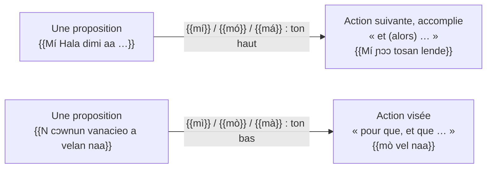
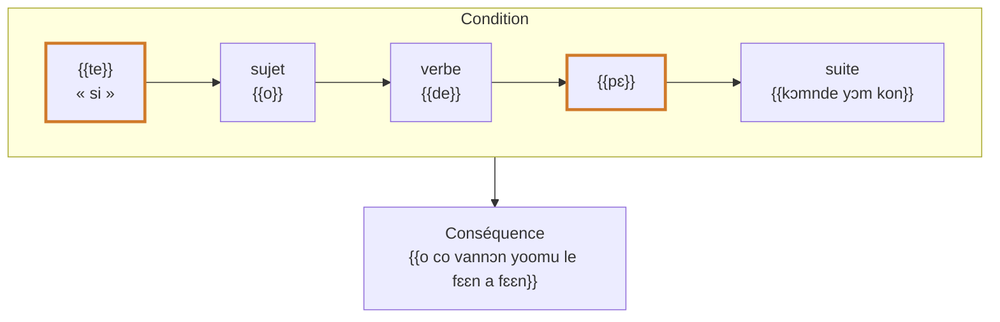

# La phrase complexe

Les règles de cette page sont dégagées des textes de la Bible en kisiei [[(BKG)]]. Les conjonctions elles-mêmes sont présentées à la page [Prépositions, postpositions et conjonctions](../small-words/prepositions-conjunctions.md).

## Enchaînement du récit : *mí*, *mó*, *má*

Le récit enchaîne les propositions avec {{mí}} + pronom (ton haut) : {{Mí Hala dimi aa … Mí ɲɔɔ tosan lende}} « Et Dieu dit… Et il en fut ainsi » [Gn 1,6-7](https://www.bible.com/bible/1394/GEN.1.6.BKG). Chaque nouvelle action est une proposition introduite par {{mí}}, {{mó}} ou {{má}} ; voir [Temps, aspects, modes](../verbs/tense-aspect-mood.md#le-recit-et-le-subjonctif-mi-pronom).

<figure class="ks-figure" markdown="1">

<figcaption>Enchaîner (ton haut) ou viser un but (ton bas) : le ton de <i>mi</i> + pronom fait la différence (Gn 1,6-7 ; Gn 1,26).</figcaption>
</figure>

## But et conséquence

| Construction | Sens | Exemple |
| --- | --- | --- |
| {{mì}} / {{mò}} / {{mà}} + verbe | pour que, et que | {{N cɔwnun vanacieo a velan naa, mò vel naa}} « Faisons l'homme à notre image, qu'il nous ressemble » [Gn 1,26](https://www.bible.com/bible/1394/GEN.1.26.BKG) |
| {{haliko}} {{mi}} … | afin que | {{haliko mi la va baloo dɔwnɔnndo}} « afin que ce soit votre nourriture » [Gn 1,29](https://www.bible.com/bible/1394/GEN.1.29.BKG) |
| {{le}} + forme longue | pour (faire) | {{le dioo}} « pour manger » [Gn 3,11](https://www.bible.com/bible/1394/GEN.3.11.BKG) |

## Cause

{{kani}} « car, parce que » et {{le tùú}} « parce que » introduisent la cause : {{kani o falun vanapɔnɔɔ nin}} « car elle a été tirée de l'homme » [Gn 2,23](https://www.bible.com/bible/1394/GEN.2.23.BKG) ; {{Le tùú n cɛl sɔɛi laa nɔm-nde}} « parce que tu as écouté la parole de ta femme » [Gn 3,17](https://www.bible.com/bible/1394/GEN.3.17.BKG). {{lelan}} et {{le hee}} « c'est pourquoi » introduisent la conséquence [Gn 2,24](https://www.bible.com/bible/1394/GEN.2.24.BKG).

## Condition : *te … pɛ*

La condition s'ouvre par {{te}} et se ferme par {{pɛ}}, placé juste **après le verbe** de la condition ; la conséquence suit :

- {{te o de pɛ kɔmnde yɔm kon, o co vannɔn yoomu le fɛɛn a fɛɛn}} « s'il mange du fruit de cet arbre, il vivra éternellement » [Gn 3,22](https://www.bible.com/bible/1394/GEN.3.22.BKG) ;
- condition irréelle avec le pronom allongé : {{te yáà de pɛ visin}} « si j'avais mangé de la viande » [Lv 10,19](https://www.bible.com/bible/1394/LEV.10.19.BKG).

Une condition négative garde {{pɛ}} et place la négation à la fin de la condition : {{Kɛ taa liila ya le, i kuenin te}} « mais si tu ne viens pas avec moi, je n'irai pas » [Jg 4,8](https://www.bible.com/bible/1394/JDG.4.8.BKG) ({{taa}} = *te* + *a* « si tu »).

<figure class="ks-figure" markdown="1">

<figcaption>La condition ouverte par <i>te</i> et fermée par <i>pɛ</i> juste après le verbe, puis la conséquence (Gn 3,22).</figcaption>
</figure>

## Temps

{{Mɛɛ}} « quand » et {{Tuma}} « au moment où » ouvrent une proposition de temps, souvent fermée par un référent de classe : {{Tuma Mɛlɛka Hala cɔw halataalaa a lɛŋnden-ndo}} « Lorsque le Seigneur Dieu fit le ciel et la terre » [Gn 2,4](https://www.bible.com/bible/1394/GEN.2.4.BKG) ; {{Mɛɛ Hala cii baala kon tosa kpow, mó mal vallo}} « Quand Dieu eut achevé son œuvre, il se reposa » [Gn 2,2](https://www.bible.com/bible/1394/GEN.2.2.BKG).

## Complétives

Après les verbes de dire, voir, savoir, vouloir, la proposition complétive est introduite par {{maa}} : {{mó ca maa n naŋ taw}} « il vit que c'était très bon » [Gn 1,31](https://www.bible.com/bible/1394/GEN.1.31.BKG) ; {{I sina nihau válán maa a nɔ siòòŋii Hala-e}} « je sais maintenant que tu crains Dieu » [Gn 22,12](https://www.bible.com/bible/1394/GEN.22.12.BKG).

## Relatives

Voir [Propositions relatives](../pronouns/relative.md).

!!! rule "Règles d'écriture"
    - Une virgule sépare la condition ou la proposition de temps de la principale : {{te o de pɛ kɔmnde yɔm kon,}} …
    - {{taa}} (« si tu ») s'écrit en un mot, comme dans la Bible.
