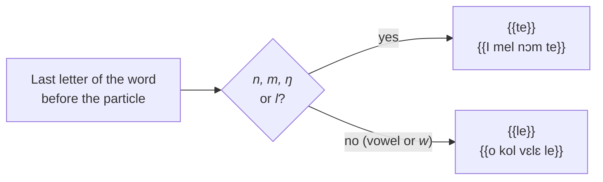
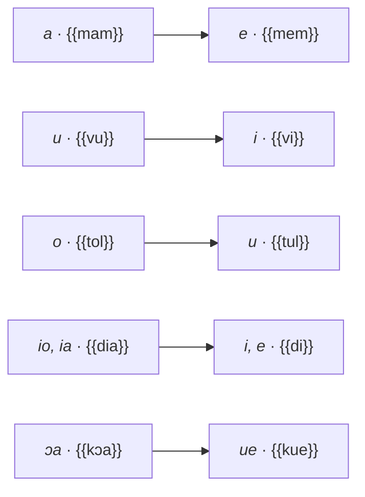

# Negation

Negation is marked by a **particle at the end of the clause**, {{le}} or {{te}}, and, for many verbs, by a **change of stem** [[(Keita1979, p. 72, 94-104)]]. The same structure is described for Southern Kissi: a final particle *le* and changes of tone and vowel on the verb [[(Childs1995, p. 222-223, 260-264)]]. The rules and examples below are drawn from the texts of the Kisiei Bible [[(BKG)]].

## The final particle: *le* or *te*

The particle is placed **at the end of the negated clause**, after the objects and complements:

- {{I sínà le}} “I do not know” [1 Sam 17:55](https://www.bible.com/bible/1394/1SA.17.55.BKG);
- {{o di ɲɛdiaa le, o kol vɛlɛ le}} “he ate no food and did not drink either” [Exod 34:28](https://www.bible.com/bible/1394/EXO.34.28.BKG).

It takes the form {{te}} when the word before it ends in a **nasal consonant** (*n*, *m*, *ŋ*) **or in *l***; after a vowel or *w*, it stays {{le}}. In the Bible, *te* follows a nasal more than 2,600 times and *l* more than 360 times, and *le* is never found after these consonants. The 1979 description mentions only the nasals [[(Keita1979, p. 72)]]; the description of Southern Kissi gives *te* after any consonant [[(Childs1995, p. 142-143)]].

- {{I mel nɔm te}} “I will not let you (go)” [Gen 32:27](https://www.bible.com/bible/1394/GEN.32.27.BKG);
- {{hali pilanndo bɛɛ la pilan te}} “do not even touch it” [Gen 3:3](https://www.bible.com/bible/1394/GEN.3.3.BKG);
- {{i kuenin te}} “I will not go” [Judg 4:8](https://www.bible.com/bible/1394/JDG.4.8.BKG);
- {{n fúlà lɛ ndu o hɔl te}} “you shall not appear before him” (after *l*) [Gen 43:5](https://www.bible.com/bible/1394/GEN.43.5.BKG);
- {{ndóò ci lɛ taw le}} “he could no longer see at all” (after *w*) [Gen 48:10](https://www.bible.com/bible/1394/GEN.48.10.BKG).

!!! rule "Spelling rule"
    - Write {{te}} after *n*, *m*, *ŋ* or *l*, and {{le}} after a vowel or *w*: {{I mel nɔm te}}, {{o hɔl te}}, but {{o kol vɛlɛ le}}, {{taw le}}.
    - The particle is always written as a separate word, at the end of the negated clause, before the comma or full stop.

<figure class="ks-figure" markdown="1">

<figcaption><i>le</i> or <i>te</i>? It depends on the last letter before the particle.</figcaption>
</figure>

## The verb in the negative

### Negative stem

Alternating verbs take a stem with a changed vowel in the negative (see [Stems and groups](stems-and-groups.md)):

| Affirmative | Negative |
| --- | --- |
| {{a mam}} “you laughed” | {{I mem te}} “I did not laugh” [Gen 18:15](https://www.bible.com/bible/1394/GEN.18.15.BKG) |
| {{mal}} “leave” | {{I mel nɔm te}} [Gen 32:27](https://www.bible.com/bible/1394/GEN.32.27.BKG) |
| {{de}} “eat” | {{o di ɲɛdiaa le}} [Exod 34:28](https://www.bible.com/bible/1394/EXO.34.28.BKG) |
| {{kɔa}} “go” | {{te naa n kue … le}} [Gen 43:3](https://www.bible.com/bible/1394/GEN.43.3.BKG) |

<figure class="ks-figure" markdown="1">

<figcaption>The vowel changes of the negative stem, affirmative on the left, negative on the right (see <a href="../stems-and-groups/">Stems and groups</a>).</figcaption>
</figure>

### Progressive and “to be” in the past: *ve*

In the negative, the past auxiliary {{va}} becomes {{ve}}: {{ɲɛ-ɲɛ ve lecoo le}} “there was nothing on it” [Gen 1:2](https://www.bible.com/bible/1394/GEN.1.2.BKG); {{vanaa … ve cɛinin te}} “the people were not in the house” [Gen 39:11](https://www.bible.com/bible/1394/GEN.39.11.BKG). Southern Kissi has the same *wa* / *we* alternation [[(Childs1995, p. 234)]].

### Future: *-nin … le / te*

The negative future keeps the suffix *-nin* and, for alternating verbs, the vowel of the negative: {{o dinin ndu tɔnɔ le}} “he will not eat of it (its fruit)” [Deut 28:30](https://www.bible.com/bible/1394/DEU.28.30.BKG); {{i kɛɛnin te}} “I will not refuse” [1 Kgs 2:20](https://www.bible.com/bible/1394/1KI.2.20.BKG).

### Prohibition (negative imperative)

The negative imperative uses the habitual stem and the final particle: {{La dia le}} “do not eat of it” [Gen 3:3](https://www.bible.com/bible/1394/GEN.3.3.BKG), {{La suunda le}} “You shall not commit adultery” [Exod 20:14](https://www.bible.com/bible/1394/EXO.20.14.BKG).

## “Not yet”, “nothing”, “nobody”

- {{vɔ}} … {{le}} “not yet”: {{Mɛlɛka Hala ndóò tuisi vɔ piɔɔ … le}} [Gen 2:5](https://www.bible.com/bible/1394/GEN.2.5.BKG);
- {{ɲɛ-ɲɛ}} … {{le}} “nothing”: {{ɲɛ-ɲɛ ve lecoo le}} [Gen 1:2](https://www.bible.com/bible/1394/GEN.1.2.BKG);
- {{vana-vana}} … {{le}} “nobody”: {{vana-vana ve lasiɛmbu … le}} [Gen 2:25](https://www.bible.com/bible/1394/GEN.2.25.BKG).

## Negating an identity

To negate “it is X”, {{co}} and the final particle are used, where the affirmative uses the particle {{ni}}: {{Hoo co masa Yuifia ni}} “this is the king of the Jews” [Luke 23:38](https://www.bible.com/bible/1394/LUK.23.38.BKG) versus {{O co dɛnɛ vana bɛnda le tosa le}} “it is not a thing that ought to be done” [Gen 20:9](https://www.bible.com/bible/1394/GEN.20.9.BKG). In this construction, Southern Kissi puts the noun's class pronoun before it [[(Childs1995, p. 261-262)]]; this point still needs to be checked for the Kisiei of Guinea.

!!! keita "1979 usage"
    The *le* / *te* rule is described in 1979 for the nasals only (“*le* is realised as *te* when the final sound of the word before it is nasal”) [[(Keita1979, p. 72)]]; the Bible extends it to *l*. The 1979 tables also give the negative of each tense (*I tyo kolö le*, *I kol te*, *I kolnin te*) [[(Keita1979, p. 96-104)]].
