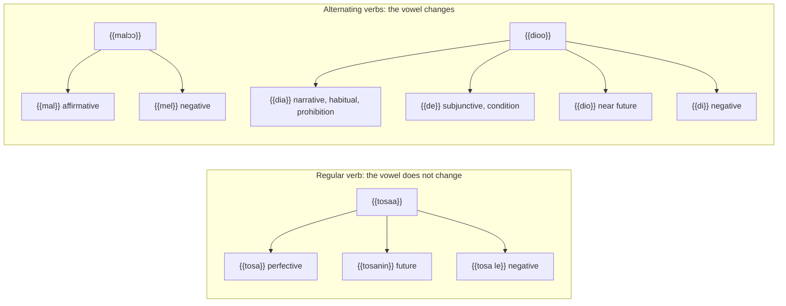

# Verb stems and groups

## Long form and short forms

Every verb has a **long form** (called the “infinitive” in 1979 [[(Keita1979, p. 90-91)]]), ending in a long vowel or a class ending, and one or more **short forms** (stems):

| Long form | Short form | Meaning |
| --- | --- | --- |
| {{tosaa}} | {{tosa}} | do, make |
| {{malɔɔ}} | {{mal}} | leave, let go |
| {{kolɔɔ}} | {{kol}} | drink |
| {{dioo}} | {{de}}, {{dia}}, {{dio}}, {{di}} | eat |
| {{kɔlan}} | {{kɔa}}, {{kɔɛ}}, {{kɔ}}, {{kue}} | go, leave |
| {{cɛlɔɔ}} | {{cɛl}} | accept |

The long form is used after the auxiliaries {{co}} and {{va}} (progressive aspect) and as a verbal noun: {{o va kelaa}} “he was walking” [Gen 6:9](https://www.bible.com/bible/1394/GEN.6.9.BKG); {{dɛnɛ vaa nuaa tosaa}} “to do such a thing” [Gen 11:6](https://www.bible.com/bible/1394/GEN.11.6.BKG). The short forms are used for the other tenses and moods and for the negative (see [Tense, aspect, mood](tense-aspect-mood.md)).

The long form is in fact a **verbal noun** of the *o* class; it ends like a noun (*-aa*, *-ɔɔ*, *-oo*, *-ndo*…). Southern Kissi likewise forms the verbal noun with the suffix *-o* [[(Childs1995, p. 202-203)]].

## Regular verbs and alternating verbs

The 1979 description sorts verbs into **four groups** according to the number of different stems [[(Keita1979, p. 101-104)]]. For Southern Kissi, a simpler distinction is made between **regular** verbs, whose vowel does not change, and **irregular** verbs, whose vowel changes with tense, aspect and polarity; tense is marked first of all by **tone** [[(Childs1995, p. 219-224)]]. The texts of the Kisiei Bible [[(BKG)]] confirm these two types:

<figure class="ks-figure" markdown="1">

<figcaption>One stem for the whole verb, or stems that change their vowel.</figcaption>
</figure>

### Regular verbs (1st group of 1979)

The vowel stays the same throughout; only the ending changes:

| Long form | Perfective | Future | Negative |
| --- | --- | --- | --- |
| {{tosaa}} | {{tosa}} | {{tosanin}} | {{tosa le}} |
| {{cɛlɔɔ}} | {{cɛl}} | {{cɛlnin}} | |

Examples: {{Mí ɲɔɔ tosan lende}} “And it was so” [Gen 1:7](https://www.bible.com/bible/1394/GEN.1.7.BKG); {{ɲɛ-ɲɛ nɔla lɛ mò kuuna nda … tosa le}} “nothing will stop them from doing…” [Gen 11:6](https://www.bible.com/bible/1394/GEN.11.6.BKG).

### Vowel-alternating verbs (2nd to 4th group of 1979)

The stem vowel changes, above all **in the negative**:

| Meaning | Affirmative | Negative | Example (Bible) |
| --- | --- | --- | --- |
| leave | {{mal}} | {{mel}} | {{I mel nɔm te}} “I will not let you go” [Gen 32:27](https://www.bible.com/bible/1394/GEN.32.27.BKG) |
| laugh | {{mam}} | {{mem}} | {{I mem te}} “I did not laugh”; {{a mam}} “you laughed” [Gen 18:15](https://www.bible.com/bible/1394/GEN.18.15.BKG) |
| eat | {{de}}, {{dia}} | {{di}} | {{o di ɲɛdiaa le}} “he did not eat” [Exod 34:28](https://www.bible.com/bible/1394/EXO.34.28.BKG) |
| go | {{kɔa}}, {{kɔɛ}} | {{kue}} | {{te naa n kue … le}} “if we do not go” [Gen 43:3](https://www.bible.com/bible/1394/GEN.43.3.BKG) |

These changes follow a few regular patterns, found across all the verbs in the [lexicon](../../reference/word-lists.md):

| Change | Examples (affirmative / negative) |
| --- | --- |
| *a* → *e* | {{mam}} / {{mem}}, {{mal}} / {{mel}}, {{ca}} / {{ce}} |
| *u* → *i* | {{vu}} / {{vi}}, {{hun}} / {{hin}} |
| *o* → *u* | {{tol}} / {{tul}}, {{kow}} / {{kuw}} |
| *io*, *ia* → *i*, *e* | {{hiow}} / {{hiw}}, {{dia}} / {{di}}, {{pial}} / {{pel}} |
| *ɔa* → *ue* | {{kɔa}} / {{kue}} |

Example: {{Taa yeema mà vi le}} “if you do not want to die” [Gen 19:17](https://www.bible.com/bible/1394/GEN.19.17.BKG) ({{vu}} “die”). The description of Southern Kissi reports the same kind of vowel alternation in its irregular verbs [[(Childs1995, p. 220-221, 241-244)]].

The negative future keeps the vowel of the negative: {{dinin}} “will not eat” [Deut 28:30](https://www.bible.com/bible/1394/DEU.28.30.BKG), {{kuenin te}} “I will not go” [Judg 4:8](https://www.bible.com/bible/1394/JDG.4.8.BKG).

### The forms of “eat” and “go”

The most irregular verbs have four stems. Their use in the Bible:

| | eat | go | Use | Example |
| --- | --- | --- | --- | --- |
| long form | {{dioo}} | {{kɔlan}} | progressive, verbal noun | {{le dioo}} “to eat” |
| stem in *-a* | {{dia}} | {{kɔa}} | narrative, habit, prohibition | {{mó dia}} “and he ate” [Gen 3:6](https://www.bible.com/bible/1394/GEN.3.6.BKG); {{má kɔa yondoo nin}} “they went to the fields” [Gen 4:8](https://www.bible.com/bible/1394/GEN.4.8.BKG); {{La dia le}} “do not eat of it” [Gen 3:3](https://www.bible.com/bible/1394/GEN.3.3.BKG) |
| stem in *-e*, *-ɛ* | {{de}} | {{kɔɛ}} | subjunctive, condition, perfective in a subordinate clause | {{mì n de}} “that we may eat” [Gen 3:2](https://www.bible.com/bible/1394/GEN.3.2.BKG); {{mì n kɔɛ}} “let us go” [Gen 4:8](https://www.bible.com/bible/1394/GEN.4.8.BKG); {{te o de pɛ}} “if he eats” [Gen 3:22](https://www.bible.com/bible/1394/GEN.3.22.BKG); {{Mɛɛ nda kɔɛ}} “when they had gone” [Num 33:8](https://www.bible.com/bible/1394/NUM.33.8.BKG) |
| short stem | {{dio}} | {{kɔ}} | near future, serial verb | {{n co ndu dio}} “you will eat of it” [Gen 2:17](https://www.bible.com/bible/1394/GEN.2.17.BKG); {{N kɔ delnun ndu coo}} “let us go and fall upon him” [Gen 37:20](https://www.bible.com/bible/1394/GEN.37.20.BKG) |
| negative | {{di}} | {{kue}} | negation | {{o di ɲɛdiaa le}} [Exod 34:28](https://www.bible.com/bible/1394/EXO.34.28.BKG) |
| future | {{dianin}} | {{kɔanin}} | future | {{nda dianin}} “they will eat” [Exod 12:7](https://www.bible.com/bible/1394/EXO.12.7.BKG) |

The distribution is clear-cut in the Bible: after {{mí}}, {{mó}}, {{má}} (narrative) we find {{dia}} and {{kɔa}} (in over 600 verses, against 7 for {{de}} or {{kɔɛ}}); after {{mì}}, {{mò}}, {{mà}} (subjunctive), {{de}} and {{kɔɛ}} (in over 300 verses, against a single one for {{dia}}). The future is built on the stem in *-a* ({{dianin}}, {{kɔanin}}). Paulme already described these two stems in the 1940s, as a present-habitual in *-a* and a perfect in *-ɛ*, the future adding *ni* to the first [[(Paulme1964, p. 48, 161)]]: {{o kɔanin}} “he will leave”, {{o kɔɛ}} “he has left” (she writes *ma kwa* “they go”, *ɔ kwani*, *ɔ kwɛ*).

!!! rule "Spelling rules"
    - Write each stem as it is pronounced: {{mal}} / {{mel}}, {{dia}} / {{di}}; do not “regularise” it.
    - The future suffix *-nin* is written **joined** to the stem: {{tosanin}}, {{dianin}}, {{kuenin}}.
    - The long form is written with its long vowel or its ending: {{tosaa}}, {{malɔɔ}}, {{dioo}}.

!!! keita "1979 usage"
    The 1979 description names the stems R1 to R4 and gives, for each group, a table of their use [[(Keita1979, p. 101-104)]], as well as a lexicon of verbs sorted by group [[(Keita1979, p. 110-118)]]. These tables are in the old orthography (*Dioo : de, dia, dio, di*; *Kölan : köè, köa, kö, koe*). The pairs are the same as in the Bible (*de* with *köè*, *dia* with *köa*), but 1979 calls the first “past” and the second “habitual”, whereas the Bible uses {{dia}} and {{kɔa}} in past narrative and {{de}} and {{kɔɛ}} in the subjunctive; the role of tone in this distribution still needs to be checked with speakers.
