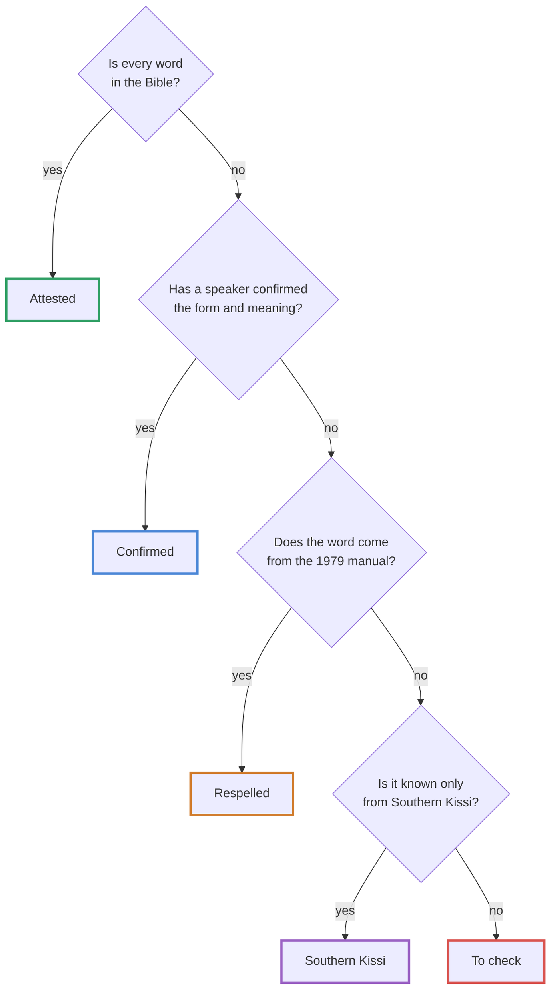

# How to read this guide

## Kisiei examples

All Kisiei words and sentences are in *underlined italics*. The colour and style of the underline show where the form comes from; details appear when you move the mouse (or your finger) over it.

| Mark | Status | What it means |
| --- | --- | --- |
| {{cɛiyo}} | Attested | Every word occurs in the Kisiei Bible [[(BKG)]], apart from tones and capitals. This is the reference spelling. |
| {{ŋɔ́ɔ́ŋŋɔ́ɔ́ŋndó\|c}} | Confirmed | The word does not occur in the Bible, but a Kisiei speaker has confirmed its form and meaning. |
| {{tafeo\|r}} | Respelled | The word comes from the 1979 manual [[(Keita1979)]] and has been respelled according to the current rules, but it does not occur in the Bible. The spelling is likely, not guaranteed. |
| {{húó\|s}} | Southern Kissi | A word known only from the Southern Kissi dictionary [[(Childs2000)]], not attested in the North; it is spelled as Childs writes it. To be checked for Guinean Kisiei. |
| {{mbara kisi\|?}} | To check | The form or meaning is uncertain: hard-to-read handwritten note, a word found only once, etc. |

<figure class="ks-figure" markdown="1">

<figcaption>How an example gets its mark. At any step, an uncertain form or meaning is marked “To check”.</figcaption>
</figure>

The status is **checked automatically** every time the site is built: an example marked “attested” containing a word that is not in the list of Bible words makes the build fail (see [Tools](../sources/tools.md)).

## References

- **Bible**: [Gen 1:3](https://www.bible.com/bible/1394/GEN.1.3.BKG) links to the verse on bible.com. The book abbreviations are the usual English ones (Gen, Exod, Matt…).
- **Keita 1979**: “(Keita 1979, p. 24)” refers to the typed page of the manual; the full transcription is in the [archive](../sources/archive.md).
- The other sources are listed in the [bibliography](../sources/bibliography.md).

## Boxes

!!! rule "Rule"
    A spelling or grammar rule to remember.

!!! keita "1979 usage"
    What the 1979 manual says when it differs from the Bible's usage. The guide follows the Bible.

!!! note "Note"
    A remark, an exception or a clarification.

## Translations

Translations of the examples are **literal** when this helps to understand the construction: words added for the English are in square brackets, and grammatical glosses in small capitals appear only in the [Grammar](../grammar/index.md) chapter.

## Technical terms

The guide avoids jargon as far as possible; the necessary terms (*stem*, *noun class*, *referent*, *tone*…) are explained in the [glossary](../reference/glossary.md).
