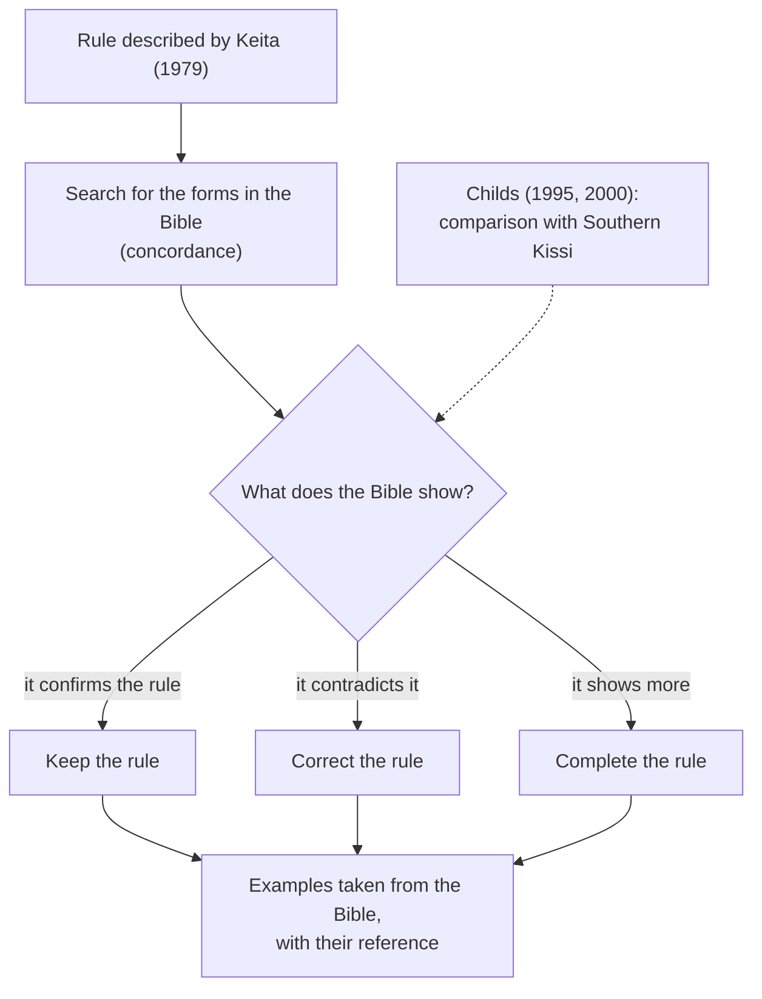

# Sources and the standard

## Why the Bible is authoritative

A spelling is useful only if everyone writes the same way. The **Kisiei Bible** [[(BKG)]] is today the longest, most widely read and most carefully proofread text in the current spelling: it contains several hundred thousand words and thousands of different words. It therefore serves as the **standard**:

1. When the Bible writes a word, write it the same way.
2. When the Bible writes the same word in two ways, take the more frequent form (often the one **without** a tone accent; see [Tone](../orthography/tone.md)).
3. When a word is not in the Bible, apply the rules of this guide; the form is marked Respelled until a speaker confirms it.

Biblical proper names ({{Abraham}}, {{Israɛl}}) follow the Bible's usage but do not serve as a model for Kisiei words.

## Keita's manual (1979)

*Kisiei fondamental* by Sékou Sondo Keita ([[Keita1979|1979]]) is a final-year thesis intended for people learning Kisiei. It describes pronunciation, noun classes, agreement, pronouns, conjugation and syntax, with exercises, dialogues and a Kisiei–French glossary of about 700 words. This guide uses it as the **basic description** of the grammar, bearing in mind three limitations:

- it is written in the **1970s spelling** (*ty*, *nh*, *ny*, *è*, *ö*), without tones;
- it contains **typing errors** and a few mistakes, sometimes corrected by hand in the surviving copy;
- some rules are **simplified** or do not match the Bible's usage (for example the spelling of relatives).

The digitised copy bears many **handwritten annotations** by later readers (translations, Kissidougou variants, corrections) [[Notes1979]]. They are cited when they shed light on a point.

## Other sources

[[Keita1979]] cites several works by the Académie des Langues and theses from the Institut polytechnique de Conakry (Tolno, Sow, Kamano, Camara, Iffono), which could not be consulted. They are listed in the [bibliography](../sources/bibliography.md) for anyone who wishes to track them down.

The most complete description published since is G. Tucker Childs's grammar in English ([[Childs1995|1995]]), supplemented by his dictionary ([[Childs2000|2000]]). Childs relies mainly on the Kissi spoken in Liberia and Sierra Leone; his analyses (tones, classes, verb) are valuable, but his forms and spelling do not apply as they are to the Kisiei of Guinea. This guide cites them as a point of comparison, never as a standard.

## Method

For each point of grammar:

1. start from Keita's description;
2. look for the corresponding forms in the text of the Bible with a [concordance tool](../sources/tools.md);
3. keep the rule if the Bible confirms it, correct it if the Bible contradicts it, and complete it with what else the Bible shows;
4. choose the examples from the Bible, with their reference; Keita's examples are used only when the Bible has nothing equivalent.

<figure class="ks-figure" markdown="1">

<figcaption>The method followed for each point of grammar. The Bible decides; Childs serves for comparison.</figcaption>
</figure>

Points that neither source can settle are collected in the [open questions](../reference/open-questions.md).
