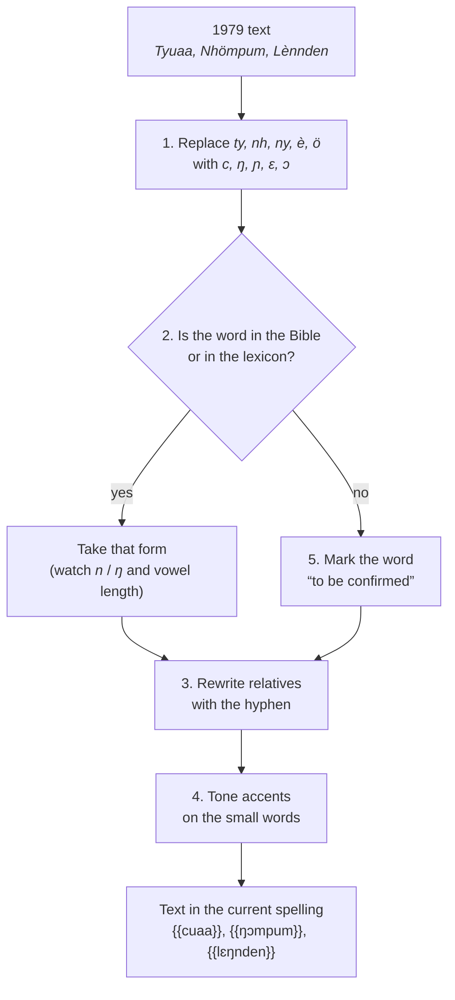

# From the old to the new spelling

Kisiei texts from the 1970s and 1980s, including Keita's manual ([[Keita1979|1979]]), are written in the old spelling. This page explains how to read them and rewrite them. The last section does the same for two older northern sources, Paulme's vocabulary (1940s) and the fables *Sandara Kissia*.

## Basic correspondences

These are the correspondences on the “new spelling” sheet [[NouvelleOrtho]], checked against the Bible [[(BKG)]]:

| Old | New | Old example | New example | Meaning |
| --- | --- | --- | --- | --- |
| *ty* | **c** | *tyuaa* | {{cuaa}} | child |
| *nh* | **ŋ** | *nhuèènu* | {{ŋuɛɛnu}} | five |
| *ny* | **ɲ** | *nyumndan* | {{ɲumndan}} | night |
| *è* | **ɛ** | *Lènnden* → | {{lɛŋnden}} | country |
| *ö* | **ɔ** | *pomböö* | {{pɔmbɔɔ}} | small, younger |
| *mb* | **mb** (unchanged) | *tyuaamböö* | {{cuaambɔɔ}} | child |

For capitals: *Ty* → **C**, *Nh* → **Ŋ**, *Ny* → **Ɲ**, *È* → **Ɛ**, *Ö* → **Ɔ**.

!!! keita "mb = nb?"
    The correspondence sheet says “*mb = nb*”. The Bible never writes *nb*: keep **mb**.

## What the basic correspondences cannot capture

Applying only the table above to the roughly 700 words of the glossary and verb list of the 1979 manual, about four words in ten are found unchanged in the Bible. For the others, either the word does not appear in the Bible (vocabulary of daily life, illnesses, tools…), or the Bible's spelling differs on one of the following points.

### 1. ŋ at the end of a stem

The old spelling wrote *n* for both [n] and [ŋ] at the end of a syllable. The Bible distinguishes them:

| 1979 | Bible | Meaning |
| --- | --- | --- |
| *Lènnden* | {{lɛŋnden}} | country, land |
| *Tyinnde* | {{ciŋnde}} | tooth |
| *Tyannda* | {{caŋnda}} | hips |
| *Tinndo* | {{tiŋndo}} | interval, space (1979: “island” [[(Keita1979, p. 155)]]) |
| *Dièn* | {{diɛŋ}} | the day after tomorrow |
| *nan* “good” | {{naŋ}} | good |

There is no mechanical rule: you need to know whether the stem ends in [n] or [ŋ] (see [Consonants](consonants.md#n-and)). When in doubt, look the word up in the Bible or in the lexicon of this guide.

### 2. Tones

The old spelling did not mark tones. When rewriting, add accents **only** where the Bible puts them: on {{mí}}/{{mì}}, {{mó}}/{{mò}}, {{má}}/{{mà}} and a few other words (see [Tone](tone.md)).

### 3. Relatives and referents

The 1979 spelling writes relatives as separate words (*Domaa n pendu vo sèsa*) [[(Keita1979, p. 88-89)]]. The Bible attaches the referent to the last word of the phrase with a hyphen ({{kɔngɔ vesɛi fula-o}}). The description of Southern Kissi likewise analyses this marker as a suffix placed at the end of the relative clause [[(Childs1995, p. 285-286)]]. See [Word division](word-division.md).

### 4. Errors and variants in the manual

The typed manual contains typing errors and some forms specific to the author's variety. Before rewriting a word from 1979, it is best to check that it is not garbled (the transcription flags doubtful passages).

## Method for rewriting an old text

1. Replace *ty, nh, ny, è, ö* with *c, ŋ, ɲ, ɛ, ɔ* (without touching the French).
2. Look up each word in the Bible or in the [lexicon](../reference/word-lists.md); if it is there, take that form (watch out for *n* / *ŋ* and vowel length).
3. Rewrite the relatives with the hyphen.
4. Add tone accents on the small words that carry them.
5. Mark the words you have not found as “to be confirmed”.

<figure class="ks-figure" markdown="1">

<figcaption>The steps for respelling a 1979 text.</figcaption>
</figure>

### Example

| 1979 | New spelling | Meaning |
| --- | --- | --- |
| *Tyuaa* | {{cuaa}} | the child |
| *Söèi* | {{sɔɛi}} | the word |
| *Nyèi* | {{ɲɛi}} | the thing |
| *Hangullo* | {{hangullo}} | the heat |
| *Yöngu ndu* | {{yɔngu ndu}} | give him |
| *Nhömpum* | {{ŋɔmpum}} | six |
| *Lènnden* | {{lɛŋnden}} | the country |

## Older northern sources: Paulme (1964) and *Sandara Kissia*

Two further northern sources predate the Bible and follow neither the 1979 spelling nor the current one:

- **Denise Paulme's vocabulary and texts** [[(Paulme1964)]], collected in 1945–1949 around Kissidougou and Guéckédou, use her own phonetic notation (her p. V): a bar over a vowel for length, a tilde for nasality, *ü*, *ẅ* and *ty*, *ny*. She marks many words G. (Guéckédou) or K. (Kissidougou).
- ***Sandara Kissia***, the fables published by the Protestant Mission of Kissidougou [[(SandaraKisia)]], use an older missionary spelling (*ty*, *ny*, *ŋg*, *gb*, *w*, *r*).

The *Lexique kissi–français* [[(LexiqueAnonyme)]] is already typed in the current spelling and needs no conversion beyond the checks below.

Neither Paulme nor *Sandara Kissia* marks tones. The table below was worked out by comparing their words with the Bible's: about 60 of Paulme's headwords with the same meaning in the Bible, and every word of *Sandara Kissia* (with these rules, the share of its running words found in the Bible rises from 59 % to 80 %). The rules hold for most words, not all: always look the result up.

| Old | Bible | Old example | Bible | Meaning |
| --- | --- | --- | --- | --- |
| *ty* | **c** | Paulme *tyal* | {{cal}} | sit, live |
| *ny* | **ɲ** | Paulme *nyunã* | {{ɲuna}} | ask |
| *t* before *u* + vowel, Paulme *tü* | **cu** | Paulme *tũei*, *tũindo* | {{cuei}}, {{cuinndo}} | axe, goat |
| *w* at the start of a word or between vowels, Paulme *ẅ* | **v** | Paulme *wana*, *ẅiyo*, *kowã* | {{vana}}, {{vííyo}}, {{koovan}} | person, orphan, blood |
| *u* after a vowel at the end of a word | **w** | *tau*, Sandara *gbou* | {{taw}}, {{kpow}} | very, all |
| *w* after a consonant | **u** | Sandara *lwɛi* | {{luɛi}} | enter |
| *y* after a vowel | **i** | Paulme *luɛy*, *pɛy* | {{luɛi}}, {{pɛi}} | enter, the day before yesterday |
| *y* between a consonant and a vowel | **i** | Paulme *kɛndya*, *sendyo* | {{kɛndia}}, {{sendío}} | health, shave |
| *gb* | **kp** | Sandara *gbou* | {{kpow}} | all |
| *r* | **l** (the Bible keeps *r* only in names and loanwords) | Sandara *re*, *kɔraŋ* | {{le}}, {{kɔlan}} | not, go |
| *ŋg*, *ŋk* | **ng**, **nk** | Sandara *yɔŋgu* | {{yɔngu}} | give |
| bar over a vowel (length) | usually a **double vowel** | Paulme *bī*, *sā*, *pā* | {{bii}}, {{saa}}, {{paa}} | catch, sheep, bone |
| tilde (nasal vowel) at the end of a noun | **vowel + n** | Paulme *balã*, *dumbulẽ*, *luã* | {{balan}}, {{dumbulen}}, {{lɔan}} | hands, roots, sleep |
| tilde at the end of a verb | often **nothing** | Paulme *nyunã* | {{ɲuna}} | ask |
| *ɛ*, *ɔ*, *ŋ*, double consonants | unchanged | Paulme *kɔllo*, *hɛlle* | {{kɔllo}}, {{hɛlle}} | heart, salt |

!!! keita "Guéckédou and Kissidougou"
    Where Paulme gives a Guéckédou and a Kissidougou form, the Bible often has the one closer to Guéckédou: Paulme *tyɛyo* (G.) / *kyɛyo* (K.) “house”, Bible {{cɛiyo}}. This is a tendency seen in a few words, not a rule; the Bible form decides.

!!! note "No mechanical conversion"
    As with the 1979 spelling, these rules give a candidate, not the answer: vowels often differ too (Paulme *kul* “drink”, Bible {{kolɔɔ}}; Paulme *luã* “sleep”, Bible {{lɔan}}). A word taken from these sources goes into the lexicon in the Bible's spelling, with the form as printed kept in its source field; if the Bible does not have it, it is marked “respelled” (see [How to read this guide](../introduction/how-to-read.md)).
