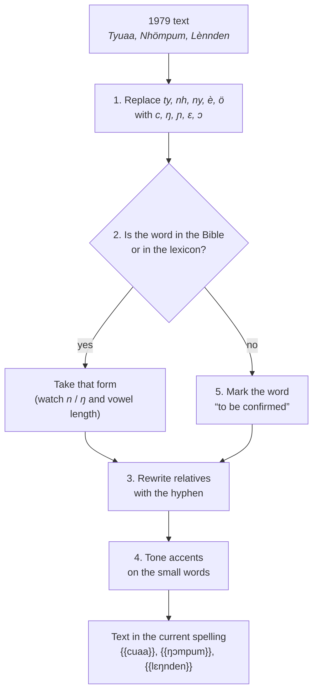

# From the old to the new spelling

Kisiei texts from the 1970s and 1980s, including Keita's manual ([[Keita1979|1979]]), are written in the old spelling. This page explains how to read them and rewrite them.

## Basic correspondences

These are the correspondences on the “new spelling” sheet [[NouvelleOrtho]], checked against the Bible [[(BKG)]]:

| Old | New | Old example | New example | Meaning |
| --- | --- | --- | --- | --- |
| *ty* | **c** | *tyuaa* | {{cuaa}} | child |
| *nh* | **ŋ** | *nhuèènu* | {{ŋuɛɛnu}} | five |
| *ny* | **ɲ** | *nyumndan* | {{ɲumndan}} | night |
| *è* | **ɛ** | *Lènnden* → | {{lɛŋnden}} | country |
| *ö* | **ɔ** | *pomböö* | {{pɔmbɔɔ}} | small, younger |
| *mb* | **mb** (unchanged) | *tyuaamböö* | {{cuaambɔɔ}} | child |

For capitals: *Ty* → **C**, *Nh* → **Ŋ**, *Ny* → **Ɲ**, *È* → **Ɛ**, *Ö* → **Ɔ**.

!!! keita "mb = nb?"
    The correspondence sheet says “*mb = nb*”. The Bible never writes *nb*: keep **mb**.

## What the basic correspondences cannot capture

Applying only the table above to the roughly 700 words of the glossary and verb list of the 1979 manual, about four words in ten are found unchanged in the Bible. For the others, either the word does not appear in the Bible (vocabulary of daily life, illnesses, tools…), or the Bible's spelling differs on one of the following points.

### 1. ŋ at the end of a stem

The old spelling wrote *n* for both [n] and [ŋ] at the end of a syllable. The Bible distinguishes them:

| 1979 | Bible | Meaning |
| --- | --- | --- |
| *Lènnden* | {{lɛŋnden}} | country, land |
| *Tyinnde* | {{ciŋnde}} | tooth |
| *Tyannda* | {{caŋnda}} | hips |
| *Tinndo* | {{tiŋndo}} | interval, space (1979: “island” [[(Keita1979, p. 155)]]) |
| *Dièn* | {{diɛŋ}} | the day after tomorrow |
| *nan* “good” | {{naŋ}} | good |

There is no mechanical rule: you need to know whether the stem ends in [n] or [ŋ] (see [Consonants](consonants.md#n-and)). When in doubt, look the word up in the Bible or in the lexicon of this guide.

### 2. Tones

The old spelling did not mark tones. When rewriting, add accents **only** where the Bible puts them: on {{mí}}/{{mì}}, {{mó}}/{{mò}}, {{má}}/{{mà}} and a few other words (see [Tone](tone.md)).

### 3. Relatives and referents

The 1979 spelling writes relatives as separate words (*Domaa n pendu vo sèsa*) [[(Keita1979, p. 88-89)]]. The Bible attaches the referent to the last word of the phrase with a hyphen ({{kɔngɔ vesɛi fula-o}}). The description of Southern Kissi likewise analyses this marker as a suffix placed at the end of the relative clause [[(Childs1995, p. 285-286)]]. See [Word division](word-division.md).

### 4. Errors and variants in the manual

The typed manual contains typing errors and some forms specific to the author's variety. Before rewriting a word from 1979, it is best to check that it is not garbled (the transcription flags doubtful passages).

## Method for rewriting an old text

1. Replace *ty, nh, ny, è, ö* with *c, ŋ, ɲ, ɛ, ɔ* (without touching the French).
2. Look up each word in the Bible or in the [lexicon](../reference/word-lists.md); if it is there, take that form (watch out for *n* / *ŋ* and vowel length).
3. Rewrite the relatives with the hyphen.
4. Add tone accents on the small words that carry them.
5. Mark the words you have not found as “to be confirmed”.

<figure class="ks-figure" markdown="1">

<figcaption>The steps for respelling a 1979 text.</figcaption>
</figure>

### Example

| 1979 | New spelling | Meaning |
| --- | --- | --- |
| *Tyuaa* | {{cuaa}} | the child |
| *Söèi* | {{sɔɛi}} | the word |
| *Nyèi* | {{ɲɛi}} | the thing |
| *Hangullo* | {{hangullo}} | the heat |
| *Yöngu ndu* | {{yɔngu ndu}} | give him |
| *Nhömpum* | {{ŋɔmpum}} | six |
| *Lènnden* | {{lɛŋnden}} | the country |
