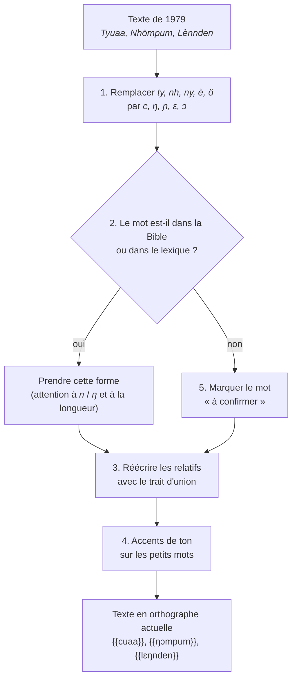

# De l'ancienne à la nouvelle orthographe

Les textes kisiei des années 1970-1980, dont le manuel de Keita ([[Keita1979|1979]]), sont écrits dans l'ancienne orthographe. Cette page explique comment les lire et les réécrire. La dernière section fait de même pour deux sources du Nord plus anciennes, le vocabulaire de Paulme (années 1940) et les fables *Sandara Kissia*.

## Correspondances de base

Ce sont les correspondances de la feuille « nouvelle orthographe » [[NouvelleOrtho]], vérifiées dans la Bible [[(BKG)]] :

| Ancienne | Nouvelle | Exemple ancien | Exemple nouveau | Sens |
| --- | --- | --- | --- | --- |
| *ty* | **c** | *tyuaa* | {{cuaa}} | enfant |
| *nh* | **ŋ** | *nhuèènu* | {{ŋuɛɛnu}} | cinq |
| *ny* | **ɲ** | *nyumndan* | {{ɲumndan}} | nuit |
| *è* | **ɛ** | *Lènnden* → | {{lɛŋnden}} | pays |
| *ö* | **ɔ** | *pomböö* | {{pɔmbɔɔ}} | petit, cadet |
| *mb* | **mb** (inchangé) | *tyuaamböö* | {{cuaambɔɔ}} | enfant |

Pour les majuscules : *Ty* → **C**, *Nh* → **Ŋ**, *Ny* → **Ɲ**, *È* → **Ɛ**, *Ö* → **Ɔ**.

!!! keita "mb = nb ?"
    La feuille de correspondances indique « *mb = nb* ». La Bible n'écrit jamais *nb* : on garde **mb**.

## Ce que les correspondances de base ne suffisent pas à rendre

En appliquant seulement le tableau ci-dessus aux quelque 700 mots du lexique et de la liste de verbes du manuel de 1979, on retrouve environ quatre mots sur dix tels quels dans la Bible. Pour les autres, soit le mot n'apparaît pas dans la Bible (vocabulaire de la vie quotidienne, des maladies, des outils…), soit l'orthographe de la Bible diffère sur un des points suivants.

### 1. ŋ en fin de radical

L'ancienne orthographe écrivait *n* pour [n] et pour [ŋ] en fin de syllabe. La Bible distingue :

| 1979 | Bible | Sens |
| --- | --- | --- |
| *Lènnden* | {{lɛŋnden}} | pays, terre |
| *Tyinnde* | {{ciŋnde}} | dent |
| *Tyannda* | {{caŋnda}} | hanches |
| *Tinndo* | {{tiŋndo}} | intervalle, espace (1979 : « île » [[(Keita1979, p. 155)]]) |
| *Dièn* | {{diɛŋ}} | après-demain |
| *nan* « bon » | {{naŋ}} | bon |

Il n'y a pas de règle mécanique : il faut savoir si le radical se termine par [n] ou par [ŋ] (voir [Consonnes](consonants.md#n-et)). Dans le doute, on cherche le mot dans la Bible ou dans le lexique de ce guide.

### 2. Les tons

L'ancienne orthographe ne notait pas les tons. En réécrivant, on ajoute les accents **seulement** là où la Bible les met : sur {{mí}}/{{mì}}, {{mó}}/{{mò}}, {{má}}/{{mà}} et quelques autres mots (voir [Tons](tone.md)).

### 3. Les relatifs et les référents

L'orthographe de 1979 écrit les relatifs comme des mots séparés (*Domaa n pendu vo sèsa*) [[(Keita1979, p. 88-89)]]. La Bible rattache le référent au dernier mot du groupe par un trait d'union ({{kɔngɔ vesɛi fula-o}}). La description du kissi du Sud analyse elle aussi cette marque comme une terminaison placée à la fin de la relative [[(Childs1995, p. 285-286)]]. Voir [Coupure des mots](word-division.md).

### 4. Fautes et variantes du manuel

Le manuel dactylographié contient des fautes de frappe et quelques formes propres au parler de l'auteur. Avant de réécrire un mot de 1979, il vaut mieux vérifier qu'il n'est pas déformé (la transcription signale les passages douteux).

## Méthode pour réécrire un texte ancien

1. Remplacer *ty, nh, ny, è, ö* par *c, ŋ, ɲ, ɛ, ɔ* (sans toucher au français).
2. Chercher chaque mot dans la Bible ou dans le [lexique](../reference/word-lists.md) ; s'il s'y trouve, prendre cette forme (attention à *n* / *ŋ* et à la longueur des voyelles).
3. Réécrire les relatifs avec le trait d'union.
4. Ajouter les accents de ton sur les petits mots qui en portent.
5. Marquer comme « à confirmer » les mots que l'on n'a pas trouvés.

<figure class="ks-figure" markdown="1">

<figcaption>Les étapes de la réécriture d'un texte de 1979.</figcaption>
</figure>

### Exemple

| 1979 | Nouvelle orthographe | Sens |
| --- | --- | --- |
| *Tyuaa* | {{cuaa}} | l'enfant |
| *Söèi* | {{sɔɛi}} | la parole |
| *Nyèi* | {{ɲɛi}} | la chose |
| *Hangullo* | {{hangullo}} | la chaleur |
| *Yöngu ndu* | {{yɔngu ndu}} | donne-lui |
| *Nhömpum* | {{ŋɔmpum}} | six |
| *Lènnden* | {{lɛŋnden}} | le pays |

## Sources du Nord plus anciennes : Paulme (1964) et *Sandara Kissia*

Deux autres sources du Nord sont antérieures à la Bible et ne suivent ni l'orthographe de 1979 ni l'orthographe actuelle :

- **le vocabulaire et les textes de Denise Paulme** [[(Paulme1964)]], recueillis en 1945-1949 autour de Kissidougou et de Guéckédou, emploient sa propre notation phonétique (sa p. V) : une barre sur la voyelle pour la longueur, un tilde pour la nasalité, *ü*, *ẅ* et *ty*, *ny*. Elle marque beaucoup de mots G. (Guéckédou) ou K. (Kissidougou) ;
- ***Sandara Kissia***, les fables publiées par la Mission protestante de Kissidougou [[(SandaraKisia)]], emploient une ancienne orthographe missionnaire (*ty*, *ny*, *ŋg*, *gb*, *w*, *r*).

Le *Lexique kissi–français* [[(LexiqueAnonyme)]] est dactylographié avec les lettres actuelles (*c*, *ɛ*, *ɔ*, *ŋ*, *ɲ*), sans tons, mais ne suit pas partout la Bible : il écrit *r* pour *l*, *nb* pour *mb* (*kunbi*, Bible {{kumbi}}), *nn* là où la Bible a *ŋn* (*lɛnnden*, Bible {{lɛŋnden}}), *ki* là où la Bible a *ci* (*kinbu*, Bible {{cimbɔɔ}}), et omet souvent le *i* après *s* (*sanie*, Bible {{sianion}}). Une bonne partie reprend aussi le glossaire du manuel de 1979, fautes de frappe comprises : il ne confirme donc pas toujours un mot de 1979 de façon indépendante.

Ni Paulme ni *Sandara Kissia* ne notent les tons. Le tableau ci-dessous a été établi en comparant leurs mots à ceux de la Bible : une soixantaine de mots-vedettes de Paulme qui ont le même sens dans la Bible, et tous les mots de *Sandara Kissia* (avec ces règles, la part de ses mots retrouvés dans la Bible passe de 59 % à 80 %). Les règles valent pour la plupart des mots, pas pour tous : il faut toujours vérifier le résultat.

| Ancien | Bible | Exemple ancien | Bible | Sens |
| --- | --- | --- | --- | --- |
| *ty* | **c** | Paulme *tyal* | {{cal}} | s'asseoir, habiter |
| *ny* | **ɲ** | Paulme *nyunã* | {{ɲuna}} | demander |
| *t* devant *u* + voyelle, *tü* de Paulme | **cu** | Paulme *tũei*, *tũindo* | {{cuei}}, {{cuinndo}} | hache, chèvre |
| *w* en début de mot ou entre voyelles, *ẅ* de Paulme | **v** | Paulme *wana*, *ẅiyo*, *kowã* | {{vana}}, {{vííyo}}, {{koovan}} | personne, orphelin, sang |
| *u* après une voyelle en fin de mot | **w** | *tau*, Sandara *gbou* | {{taw}}, {{kpow}} | très, tout |
| *w* après une consonne | **u** | Sandara *lwɛi* | {{luɛi}} | entrer |
| *y* après une voyelle | **i** | Paulme *luɛy*, *pɛy* | {{luɛi}}, {{pɛi}} | entrer, avant-hier |
| *y* entre une consonne et une voyelle | **i** | Paulme *kɛndya*, *sendyo* | {{kɛndia}}, {{sendío}} | santé, raser |
| *gb* | **kp** | Sandara *gbou* | {{kpow}} | tout |
| *r* | **l** : le kisiei ne distingue pas *l* et *r* ; certains parlers (Kissidougou, où *Sandara Kissia* a été écrit) disent *r* là où d'autres disent *l*, et la Bible écrit toujours *l* (*r* seulement dans les noms propres et les emprunts ; voir [Variétés régionales](../introduction/dialects.md)) | Sandara *re*, *kɔraŋ* | {{le}}, {{kɔlan}} | ne… pas, aller |
| *ŋg*, *ŋk* | **ng**, **nk** | Sandara *yɔŋgu* | {{yɔngu}} | donner |
| barre sur la voyelle (longueur) | le plus souvent une **voyelle double** | Paulme *bī*, *sā*, *pā* | {{bii}}, {{saa}}, {{paa}} | saisir, mouton, os |
| tilde (voyelle nasale) à la fin d'un nom | **voyelle + n** | Paulme *balã*, *dumbulẽ*, *luã* | {{balan}}, {{dumbulen}}, {{lɔan}} | mains, racines, sommeil |
| tilde à la fin d'un verbe | souvent **rien** | Paulme *nyunã* | {{ɲuna}} | demander |
| *ɛ*, *ɔ*, *ŋ*, consonnes doubles | inchangés | Paulme *kɔllo*, *hɛlle* | {{kɔllo}}, {{hɛlle}} | cœur, sel |

!!! keita "Guéckédou et Kissidougou"
    Quand Paulme donne une forme de Guéckédou et une de Kissidougou, la Bible a souvent celle qui est proche de Guéckédou : Paulme *tyɛyo* (G.) / *kyɛyo* (K.) « maison », Bible {{cɛiyo}}. C'est une tendance observée sur quelques mots, pas une règle ; c'est la forme de la Bible qui décide.

!!! note "Pas de conversion mécanique"
    Comme pour l'orthographe de 1979, ces règles donnent une forme candidate, pas la réponse : les voyelles diffèrent souvent aussi (Paulme *kul* « boire », Bible {{kolɔɔ}} ; Paulme *luã* « sommeil », Bible {{lɔan}}). Un mot tiré de ces sources entre dans le lexique dans l'orthographe de la Bible, avec la forme imprimée conservée dans son champ de source ; si la Bible ne l'a pas, il est marqué « réécrit » (voir [Comment lire ce guide](../introduction/how-to-read.md)).
